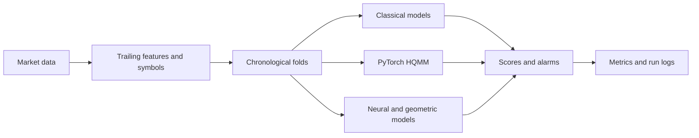
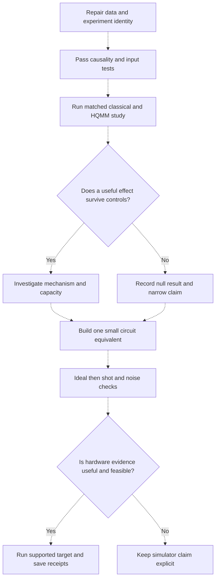
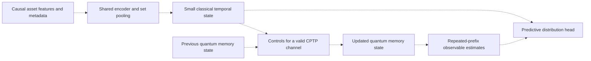
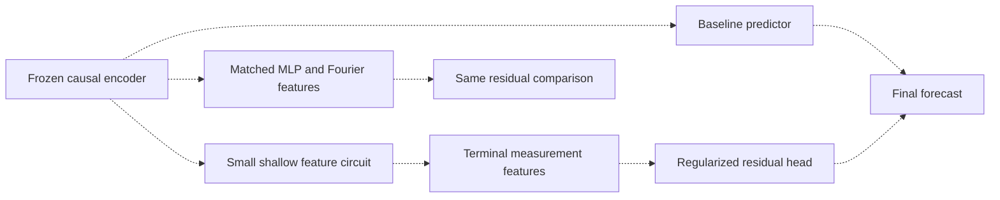

# Eq-HQMM research review and hybrid model development plan

- **Repository:** [Sarahsusangeorge/fds-eqhqmm](https://github.com/Sarahsusangeorge/fds-eqhqmm)
- **Reviewed source commit:** `85347b4d16736abbcb6ed67245836d4923612f49`
- **Evidence cutoff:** 20 October 2026
- **Scope:** source observations, saved-result reconciliation, literature comparison, contribution assessment and unimplemented research designs.

This document contains the complete technical review in one file. It distinguishes what the code implements, what saved records report, what the arithmetic supports and what remains a proposed experiment. It does not present newly executed model or hardware results. The literature coverage is scoped, not exhaustive.

## Contents

- [Assessment of the work, code and contribution](#assessment-of-the-work-code-and-contribution)
- [Current implemented pipeline](#current-implemented-pipeline)
- [Execution order and acceptance criteria](#execution-order-and-acceptance-criteria)
- [Technical analysis and six detailed paper studies](#technical-analysis-and-six-detailed-paper-studies)
- [Hybrid classical and quantum model designs](#hybrid-classical-and-quantum-model-designs)
- [Recomputed saved-market results](#recomputed-saved-market-results)
- [Detailed implementation observations](#detailed-implementation-observations)
- [Literature comparison table](#literature-comparison-table)
- [Bibliographic identities and inspected source locations](#bibliographic-identities-and-inspected-source-locations)
- [Official execution interfaces](#official-execution-interfaces-checked-on-20-october-2026)
- [Saved-log identities and arithmetic verification](#saved-log-identities-and-arithmetic-verification)
- [Original analytical diagnostics](#original-analytical-diagnostics)

## Assessment of the work, code and contribution

**The project has a good mathematical core and several useful engineering components. Its experimental conclusions are not yet reliable. Novelty is not established by the current evidence.** These are separate assessments.

| Area | Observation | Assessment |
| --- | --- | --- |
| Quantum formalism | Local QR/isometry construction, explicit Kraus updates and register-only reset reduction have a coherent mathematical basis. | Retain and verify these components. |
| Implementation structure | Shared interfaces, separate builders/readouts, chronological harness and substantial algebraic tests are present. | Useful research infrastructure. |
| Test quality | Tests cover completeness, probability normalization, gradients and reduced/dense agreement. Some critical experiment paths are untested. Tests were inspected, not executed in this review. | Good mathematical test design; incomplete integration coverage. |
| Experiment correctness | Inactive correlation conditioning, noncausal combined normalization, unconditional confirmation text, incorrect noise semantics and duplicate robustness rows were found. | Current experiment outputs cannot all be accepted. |
| Reproducibility | The main tables reconcile with tracked logs, but raw market data, predictions, label arrays, exact Basket B tickers and complete run signatures are missing. | Arithmetic consistency exists; full experimental reproduction is not established. |
| Scientific contribution | HQMMs, quantum learning, symmetry-aware QML, classical geometric market features and HQMM stock forecasting already have prior literature. | Combining the labels does not establish novelty. |
| Hardware status | The snapshot contains PyTorch quantum-instrument simulation, without a Qiskit execution adapter or provider receipts. | A hardware implementation remains separate work. |

The strongest existing technical asset is the exact symmetry-aware reduction and its tests. The weakest part is the experiment integration and interpretation. A blanket description such as “bad code” discards the sound components; a blanket description such as “research-ready” ignores defects that can reverse or invalidate results.

### What is already established elsewhere

| Proposed headline | Existing literature or current evidence | Consequence |
| --- | --- | --- |
| Use an HQMM for sequential modelling | Q01-Q06 develop definitions, learning, continuous embeddings, tensor formulations and split-state extensions. | HQMM usage alone is not a new method. |
| Use quantum models for financial prediction | Q09 studies HQMM stock prediction in 2025. Its empirical defects are documented below. | A broad first-HQMM-finance claim is unsupported. Regime detection is a different task, but still requires a targeted comparison. |
| Impose permutation symmetry on QML | Q10-Q13 supply constructions and conditional guarantees. | The contribution must identify what is specific to the complete sequential instrument. |
| Use Hilbert-space geometry to detect market stress | F04 contains a related classically executed framework; F07/F08/F13 cover non-quantum geometric or spectral alternatives. | A geometric detector must be defined by its actual formulas and evaluated against those alternatives. |
| Claim efficiency because Hilbert space grows exponentially | Q15 gives efficient classical algorithms for specified symmetric settings; the current builder already exploits a symmetric subspace. | State preparation, access assumptions and the strongest applicable classical simulation must be included. |
| Insert a quantum layer into a classical network | N01 benchmarks hybrid and quantum classifiers; N02 explains Fourier structure of encoding; N03 supplies a kernel perspective. | A quantum layer needs an incremental contribution beyond its classical host and matched feature controls. |

### Specific contribution candidates worth developing

These are testable candidates, not certified new results. Each requires checking its closest literature before a priority claim.

1. **Exact compressed filtering for the reset-equivariant instrument.** The current fast builder reduces gate construction but still expands asset amplitudes or enumerates ordered outcomes. Under the reset/shared-readout symmetry established in R10, each day's register branch map depends on a symbol histogram. Derive the multiplicity-aware histogram instrument, build a reduced implementation and prove its agreement with the existing model. For n=9 and K=3, there are 55 histograms rather than 19,683 ordered outcomes. This is a possible reduction in outcome enumeration, not proof that every part of training becomes polynomial.
2. **Causally controlled quantum memory.** Feed a classical causal basket representation into a small CPTP memory channel and measure a stress readout. This avoids interpreting every observed market vector as a forced quantum measurement outcome. Specify how sector metadata and correlations affect the channel. The architecture remains subject to repeated-prefix execution and classical simulation comparisons.
3. **A mechanism study separating symmetry, coherence and preprocessing.** Construct matched full/dephased/diagonal and classical histogram/OOM variants. Report when a benefit survives each intervention and when it disappears. A precise explanation of that boundary is more defensible than an unrestricted quantum-superiority headline.
4. **A reproducible causal regime-detection benchmark.** Freeze data, labels, event matching, dependent-time uncertainty and resource measurements. A corrected benchmark can be useful, but merely running a larger model list on the same panel is insufficient differentiation.

For the compressed-filtering candidate, let $c=(c_0,\ldots,c_{K-1})$ be an observation histogram and choose a canonical ordered sequence $y(c)$. Under R10's exact reset/readout assumptions, write the identical register branch map for every permutation as $\mathcal E_{y(c)}$. The histogram map is

$$
\mathcal F_c(\rho)=\frac{n!}{\prod_k c_k!}\,\mathcal E_{y(c)}(\rho).
$$

Then $\sum_c\operatorname{Tr}\mathcal F_c(\rho)=1$. This multiplicity is essential when fitting histogram likelihood. An ordered-vector likelihood instead uses the individual branch map. The two log-likelihoods differ by the data-only log multiplicity term. On identical records with exact symmetry, this constant does not change the parameter optimum, but it changes reported likelihood values and must be included when claiming normalized histogram probabilities. The identity follows from the restricted symmetry assumptions; it does not apply automatically to a nonuniform correlation-conditioned channel.

**Required successful work:** produce a proof or a preserved, independently checked experiment for one of these concrete contributions. Do not manufacture a positive result. If a candidate fails its criterion, report the failure and move to the next defensible contribution.

## Current implemented pipeline

| Diagram relationship | Source | Evidence status |
| --- | --- | --- |
| Market data to trailing features/symbols | `data/market_data.py`, `data/features.py`, `data/discretize.py`; R05/R12 | Explicit source interfaces; no data download reproduced. |
| Features/symbols to folds and model fitting | `harness/folds.py`, `harness/runner.py`; R01/R07/R08 | Explicit implementation path; R01 documents configuration failure in the older driver. |
| Model branches to scores and alarms | `models/base.py`, `models/hqmm/model.py`, `harness/alarms.py`; R06/R13 | Explicit code interfaces. This diagram does not assert that every branch has tracked market runs. |
| Scores/alarms to metrics and logs | `harness/metrics.py`, `harness/runner.py`, `harness/report.py`; R02/R13/R17 | Explicit implemented path with the documented aggregation/provenance limitations. |

## Execution order and acceptance criteria

This is a proposed execution dependency graph, not a statement that these steps have run. A failed modelling-benefit hypothesis does not prevent a separately useful component-equivalence demonstration; it prevents presenting that demonstration as a market advantage.

| Proposed edge group | Basis | Status |
| --- | --- | --- |
| A to B to C | R01-R09 and R14-R18 identify errors that confound a fair comparison. | Proposed dependency; repairs unimplemented. |
| C to D to E/F | Existing negative results and the ablation protocol require acceptance of either positive or null outcomes. | Proposed scientific decision rule. |
| E/F to G to H | D03-D06 distinguish numerical channels, circuits and physical execution. | Proposed implementation sequence; no conversion executed. |
| H to I to J/K | D01/D02/D07-D09 specify target restrictions; actual access and resources remain unknown. | Proposed backend decision; no hardware success asserted. |

| Work package | Concrete output | Acceptance condition |
| --- | --- | --- |
| W01 Recover provenance | Exact Basket A/B universe, raw-data hashes, split dates, label availability, environment lock, run identity. | Every table row maps to one immutable data/config/model signature. |
| W02 Repair experiment paths | Correct schema, dynamic correlation wiring, score causality, OOM support, neural boundaries, noise channels, augmentation selection/logging. | Focused regression tests fail on the old behavior and pass on the repaired path. |
| W03 Regenerate claims and tables | Unique paired robustness runs; conclusions derived from results; denominators and failed runs retained. | No hardcoded confirmation; no undocumented deduplication or cherry-picking. |
| W04 Validate the mathematical core | Classical HMM special case, completeness, branch probabilities, density positivity, gradients and reduced/dense equivalence. | Saved tolerances and outputs; no dependence on later observations. |
| W05 Establish contribution | One primary endpoint, matched classical input/capacity budgets, dephasing and symmetry controls, held-out periods. | Effect is useful under the declared margin and uncertainty, or explicitly reported null. |
| W06 Complete a small circuit | Valid dilation or feature-controlled channel, exact-reference comparison, finite shots, noise, compiled resources. | Probability and state/readout errors within the frozen tolerance; no fake hardware receipt. |

## What can be claimed after each successful result

| Successful result | Defensible statement | Still not established |
| --- | --- | --- |
| Completeness and reduced/dense equality pass | The specified instrument and reduction are correct within stated assumptions/tolerances. | New scientific method, better market prediction or quantum speedup. |
| Histogram reduction matches the original and removes an enumeration bottleneck | The restricted instrument admits the proved compressed implementation with measured resource savings. | Applicability to arbitrary conditioned channels or all HQMMs. |
| Full model improves over retuned dephased and classical controls | The tested quantum-state representation contributes under this dataset/protocol/budget. | Universal superiority or hardware efficiency. |
| Hybrid model adds value beyond its host and matched feature models | The quantum-derived feature or channel improves the declared endpoint in the tested setting. | That another classical feature family cannot reproduce the effect. |
| Physical circuit agrees with exact probabilities within uncertainty | The circuit component is physically feasible on the named backend and job. | Full financial pipeline execution or quantum advantage. |

## Remaining evidence boundaries

The source-code observations are static findings. Saved-log arithmetic was independently recomputed. Original mathematical counterexamples were run separately. Student model fitting, upstream tests, quantum simulation, hardware execution and the proposed hybrid architectures were not executed in this review. A complete literature table and exact source links follow; reading levels are explicit.

## Technical analysis and six detailed paper studies

## The problem must be defined before the model

Market regime is a modelling construct rather than a directly observed physical label. A bull/bear state, a high-volatility episode, a correlation breakdown and the onset of a dated crisis are related but different targets. A model may recognize an ongoing stress period while failing to warn of its onset. It may also produce useful predictive distributions without agreeing with a hand-built regime label.

Choose one primary task and keep the others secondary. A defensible primary task is causal detection of a newly entered stress regime using information available at the close of day t, followed by action no earlier than the next executable price. A second valid task is one-step predictive likelihood of discretized returns. These must be evaluated separately: a high day-level average precision does not establish early transition detection, and a good sequence likelihood does not identify an economically meaningful latent state.

For each target define the observable information set, label construction, onset time, label availability time, action time and matching tolerance. If labels use future drawdown to mark a peak retrospectively, report the peak date and the later date at which the label becomes knowable. Retrospective labels can be valid evaluation targets, but they cannot be supplied to training or threshold calibration before their availability date.

A usable target sheet would contain one row per label definition. For example: volatility stress determined by a trailing realized-volatility rule; drawdown onset defined by a frozen peak-to-trough rule; an exogenous event calendar; and synthetic latent switches with exactly known times. Define the direction of each score and avoid choosing it after observing test performance. Freeze event merging, cooldown and one-to-one alarm matching rules before running the comparison.

The strongest primary result would report event recall and detection delay at a common validation-calibrated false-alarm rate, together with performance on at least one label family not mechanically defined by the model's main feature. A volatility detector scoring highly against a volatility threshold is expected alignment, not evidence that it has discovered a new latent financial structure. AUPRC remains useful for imbalanced day-level labels, with prevalence and valid-fold counts shown beside it.

## What an HQMM contributes mathematically

An HMM maintains a classical probability vector over latent states. A quantum instrument maintains a density matrix rho, which is positive semidefinite and has trace one. For observation y, let the branch map be E_y(rho) = sum_a K_y,a rho K_y,a^dagger. The observation probability is p(y|past) = Tr[E_y(rho)], and the conditional update is rho' = E_y(rho)/p(y|past). The complete instrument is valid when sum_y,a K_y,a^dagger K_y,a = I. This is the relevant trace-preservation condition across all possible observations.

An observed branch may be nonunitary even if it has one Kraus operator. It is the complete trace-preserving map with a single Kraus operator, on the same input and output dimension, that must be unitary. Students should derive this distinction rather than repeat an imprecise statement from a paper. Unitary mixing, measurement, conditioning and resetting are different operations.

The potential modelling difference is that noncommuting quantum states and operators can encode predictive processes differently from a finite classical HMM. Some synthetic processes admit compact quantum representations relative to certain classical state models. This does not imply that arbitrary financial data favor quantum channels, that equal hidden-state counts imply equal capacity, or that classical simulation of a small HQMM is inefficient. The HQMM literature establishes opportunities and constraints, not a finance advantage [Q01-Q03].

For a d-dimensional hidden quantum state there are d^2-1 real density-matrix coordinates before model restrictions. A classical HMM with d hidden states has a d-1-dimensional posterior simplex. Comparing those two models solely by the number d privileges one representation. Report at least two classical controls: one matched by trainable parameter or tuning budget, and one allowed enough states/rank to match predictive quality. Include spectral OOM or predictive-state methods because a quantum density update also has a linear-operator representation in a larger real coordinate space.

The most direct mechanism test is a dephasing intervention: compare the full instrument with a variant that removes selected off-diagonal coherences after each step. Retune both under the same budget. If performance is unchanged within uncertainty, coherence has not been shown necessary for this task. If it changes, rule out parameter, optimization and regularization differences before attributing a financial benefit to quantum coherence.

An original two-state diagnostic in this review illustrates the distinction only. A coherent plus-state and its dephased version have the same computational-basis populations, but a subsequent Hadamard produces probability approximately 1 versus 0.5 for outcome zero. This proves that coherence can affect later measurements in a simple construction. It is not a trained HQMM result, a market result or a hardware observation.

## What geometric symmetry contributes

Permutation equivariance means that consistently relabeling assets transforms internal representations in a predictable way. A scalar market-risk score would ordinarily be invariant to a mere change in column order. If returns are permuted, asset metadata, portfolio weights, sector information and correlation matrices must move with them. For a correlation matrix C, the consistent transformation is P C P^T.

Reordering a fixed basket is a representation test. Replacing one asset with another is a distribution-shift test. An equivariance proof for the first operation does not establish robustness to the second. Full exchangeability may also be too strong if asset identity or sector structure is economically relevant. A classical model can preserve column-order invariance while using metadata through a shared per-asset encoder and invariant aggregation [F05].

The quantum symmetry literature shows how structured ansatzes can control expressivity, training and sample requirements under stated conditions [Q10-Q15]. Those guarantees depend on the encoding, observables, cost and data family. They cannot be transferred automatically to an arbitrary sequential instrument with measurement and resetting. Verify covariance of the entire branch map and invariance of the chosen score, not just commutation of one unitary layer.

Symmetry can also make a model easier to simulate classically. If the circuit evolution remains in a symmetric asset subspace, exploiting that structure is a valid algorithmic improvement. It simultaneously weakens any argument that the full 2^n asset Hilbert space is providing an unavoidable computational resource. The repository's optimized equivariant builder already uses such a reduction; its existence should be discussed openly.

There are two distinct notions of geometry in this project. One is group symmetry in a quantum model. The other is a geometric observable of financial data, such as covariance spectra, subspace motion or a Hilbert-space embedding. Neither necessarily requires a QPU. Their combination should be evaluated with separate ablations so that any improvement can be assigned to symmetry, preprocessing, a geometric feature or quantum state dynamics.

## Six papers for detailed student study

### Study 1 Learning Hidden Quantum Markov Models

Read Srinivasan, Gordon and Boots, AISTATS 2018 [Q02]. Full-text locations, mechanism details and limitations are recorded in the source records below. The paper builds a bridge from classical HMMs to quantum instruments and develops a learning method. Its experimental support is primarily controlled synthetic data, where representation and predictive accuracy can be examined with known generating processes. It is a foundation for the implemented channel formalism, not a validation of market crash prediction.

Required study: reproduce the complete-instrument constraint, explain the conditional update and distinguish state dimension from parameter budget. First verification task: a tiny classical HMM embedded into an HQMM and checked by exact sequence probabilities. Require probabilities to sum to one across all possible short sequences and require agreement with a separately implemented classical forward algorithm.

Question to resolve: Which restriction in the classical baseline are you relaxing, and does your data-generating process require it? An answer based only on superposition or entanglement is insufficient. The useful deliverable is a model-class diagram and a numerical probability-equivalence table. Failure to reproduce the classical special case is a stop condition before finance experiments.

### Study 2 Expressiveness and Learning of Hidden Quantum Markov Models

Read Adhikary, Srinivasan, Gordon and Boots, AISTATS 2020 [Q03]. This paper is especially relevant to the requirement for a precise representational rationale. It relates HQMMs to observable-operator models and studies expressiveness and learning. The source records below identify the sections supporting those relationships and the limits of the demonstrations.

Verification task: vectorize the density matrix and write the observation map as a linear operator on that vector. They should explain which positivity constraints distinguish a physically valid instrument from a generic predictive linear model. Then compare a spectral OOM with the HQMM on the same symbol sequences, selected rank and chronology.

Check whether any measured gain survives an OOM/PSR competitor and whether quantum dimension, real state dimension, trainable parameters and computational cost are all reported. A failure to beat an adequately tuned OOM is informative: the contribution may be a constrained, interpretable or symmetry-aware operator model rather than an inaccessible classical process. Do not use a restricted HMM alone as the universal classical comparator.

### Study 3 Theoretical guarantees for permutation equivariant quantum neural networks

Read Schatzki and colleagues, npj Quantum Information 2024 [Q13]. The study provides theoretical guarantees for a specified family of permutation-equivariant quantum networks and discusses classical simulation. Read the assumptions and the discussion of adversarial data, not only the abstract. Its statements do not amount to a general no-barren-plateau or quantum-speedup guarantee for this financial HQMM.

Verification task: prove scalar-score invariance for the implemented initial state, transition, measurement and readout together. Test consistent fixed permutations across a sequence, independent permutations at each day, and permutations of returns with and without their metadata. These probes distinguish the actual symmetry assumption from an informal claim of robustness.

Require a classical symmetry control, preferably histogram-HMM plus DeepSets-GRU, and a capacity-matched generic HQMM. If the equivariant quantum model improves only against a poorly tuned generic circuit, the result concerns inductive bias under that comparison. It has not established a benefit over classical invariant learning. If an exact symmetric-subspace solver matches it, report that as an algorithmic contribution and use the solver as the principal simulator baseline.

### Study 4 Learning hidden Markov models with persistent states by penalizing jumps

Read Nystrup, Lindstrom and Madsen, ESWA 2020 [F03], Sections 3-5. The objective trades observation fit against a penalty on state changes. The paper studies simulated and financial series; Table 6 concerns 1000 simulated heavy-tailed series and reports turnover 21.52 for MLE versus 4.55 for jump estimates. That comparison supports persistence-aware baselines, not a universal trading claim. The manuscript explicitly leaves a streaming extension of its joint estimator outside scope.

Verification task: implement the penalty-based state objective and then specify how it will be used causally. A batch path fitted over the full test period is prohibited as an online detector. An acceptable baseline can fit parameters on training data and use a declared forward decision rule, or use a separately justified online jump-model variant. Label any such adaptation precisely.

Check whether the proposed quantum memory improves detection beyond a simple persistence mechanism at the same false-alarm budget. If not, a complicated channel is not justified by reduced chattering alone. The required output is a switching-rate versus delay curve and a next-day, cost-aware exposure experiment. A high penalty that eliminates alarms should not be called robust; missed events belong on the same chart.

### Study 5 Bayesian Online Changepoint Detection

Read Adams and MacKay 2007 [F02], Section 2, Algorithm 1 and Section 3. The paper recursively tracks a posterior over the time since the last change. It combines a hazard with run-specific predictive likelihoods and includes a Dow Jones variance example. Exact per-step cost grows with retained run lengths; pruning trades exactness for bounded computation. The assumptions include independent segments and a chosen within-segment predictive family.

Verification task: reproduce a mean-shift and a variance-shift sequence using an explicitly documented update convention. They must inspect the alarm statistic: under the original recurrence and a constant hazard, the normalized reset mass can remain equal to the hazard. A useful signal may instead be predictive surprise or posterior mass on a declared set of short run lengths, with index timing derived carefully. Calling any implementation BOCPD does not prove that its alarm is informative.

Check how sensitive the result is to hazard, truncation, heavy tails and smoothing. Require a no-change control, an abrupt change and a gradual transition. The correct deliverable is a causal score trace and posterior heatmap with event times, not merely one aggregate classification score. The repository's existing BOCPD implementation must be assessed against its actual recurrence rather than assumed to match every detail of the source paper.

### Study 6 Geometric Observables for Financial Regime Detection

Read Hammond 2026, arXiv v1 [F04], Sections 2-3 and 5-6. It computes geometry from an error-Hamiltonian embedding on classical hardware. Its Berry observable uses curvature from a plaquette construction, unlike a correlation-eigenvector angle. The paper reports Berry walk-forward median d=0.72 with interval [0.34,1.18]; its offline panel and causal panels differ. Treat the result as a preprint claim, not an independently reproduced performance target.

Verification task: create a formula-to-code mapping for every comparator. A real leading-eigenvector angle measures projective subspace motion; it is not, by itself, a Berry phase or curvature measurement. Correlation spectral entropy also differs from entropy of Hamiltonian excitation-energy weights. Rename the existing baselines accordingly unless the original method is faithfully implemented.

Check which geometry is actually being measured, how it is normalized causally and whether a simple covariance feature performs equally well. Require a shrinkage-covariance control and an eigenvalue-gap sensitivity check: a leading eigenvector can move sharply near degeneracy without an economically meaningful transition. The paper's different false-alarm figures refer to different channels or versions; do not mix them into one headline. The research lesson is to trace each numerical claim to its exact experiment.

## Assessment of reported and recomputed results

Recomputed result tables and exact source findings appear below. They are evidence of what is recorded, with the provenance limitations stated there. The most significant scientific observation in the narrative notes is that changing input normalization can produce a much larger improvement than changing the model. The documented training-volatility synthetic comparison gives categorical HMM AUPRC 0.97, spectral OOM 0.95 and generic HQMM 0.94, versus weaker HQMM behavior under trailing-volatility symbols. These are supplied synthetic results; they were not rerun.

The same notes report an equivariant HQMM AUPRC of 0.944, a size-matched generic HQMM 0.912, a smaller generic HQMM 0.940 and categorical HMM 0.970 in a three-asset synthetic setting. Four folds and three seeds do not establish a general effect. The smaller generic model and classical comparator are especially important counter-evidence. Keep these results visible even if a later favorable run is found.

Two inferences are reasonable at this stage. First, preprocessing and the definition of stress can dominate the apparent architecture result. Second, symmetry can be verified algebraically or numerically without proving predictive superiority. Neither inference implies that no useful HQMM financial model can exist. They identify the experiments necessary to support a narrower contribution.

Do not report a seed-level bootstrap as uncertainty over future market periods. Seeds vary optimization; chronological market blocks vary deployment conditions. Expanding training windows also make fold outcomes dependent. Show per-seed results within each market block, then use block-aware or hierarchical uncertainty appropriate to the endpoint. A Wilcoxon test over overlapping folds is a sensitivity analysis unless its independence assumptions are defended.

Use missing values explicitly. AUPRC is undefined for certain single-class test windows; event recall is undefined when there is no event. A model with no alarms still has relevant false-alarm and missed-event outcomes. Avoid silently dropping no-alarm folds or reporting an average lag only among the easiest detected events without recall beside it. A displayed p value of 0.00 is rounding, not a probability of exactly zero.

## Matched classical comparisons

Use a deliberately small core comparison set before adding every available architecture. The first tier should be a naive volatility or concentration score, Gaussian and categorical HMMs, a persistence-aware jump model, BOCPD and a spectral OOM. The second tier should include GRU or LSTM, TCN, a compact causal Transformer and DeepSets-GRU. The third tier compares generic HQMM, equivariant HQMM, dephased variants and any valid correlation-conditioned extension.

Provide two comparison tracks. In the representation-matched track, each sequence model receives exactly the same discretized observations or the same frozen features. In the application track, each method can use its appropriate continuous or categorical representation, with an equal and disclosed tuning budget. The first track tests the channel; the second tests a useful detection system. The conclusions should identify which track supports them.

For an exchangeable basket, compare a classical HMM whose observations are per-day symbol counts. For n assets and K categories, the count-vector alphabet has binomial(n+K-1,K-1) possible histograms, rather than K^n ordered vectors. With n=9 and K=3, that is 55 count patterns versus 19,683 ordered vectors. This is a derived combinatorial comparison, not a performance result. It makes an especially important control when the quantum reset channel has the same effective symmetry.

Match more than trainable parameter counts. Record state dimension, objective, optimizer, early-stopping rule, validation information, number of tuning trials, epochs, wall time, feature access and initialization. A supervised tree trained on stress labels and an unsupervised HQMM trained by likelihood solve different estimation problems. Both may belong in an application benchmark, but their supervision must be disclosed and the HQMM cannot be declared inferior or superior in representation from that comparison alone.

Capacity should be presented as a curve. Increase classical HMM state count and OOM rank until quality saturates or the shared compute limit is reached. Plot predictive score, event performance and runtime. If a compact quantum model reaches the same quality with fewer latent dimensions but substantially greater fitting time, report both facts. Claims of statistical compactness, faster classical simulation and physical quantum speedup are different claims.

## Proposed temporal validation protocol

EXP-01 is an evaluation repair and deterministic replay. Freeze a data snapshot with source, tickers, extraction date, price-adjustment convention, trading calendar, missingness policy and hashes. Reconstruct the second basket exactly. Preserve raw observations and generate features from a versioned script. The final row used for training, validation and testing must be printed for every fold.

Define the first training period, a later validation period and the next non-overlapping test block. Advance the boundary in a rolling or expanding scheme and keep that choice fixed. Fit scaling, discretization, PCA, model parameters, calibration and alarm thresholds only on their allowed training/validation observations. Data-dependent operations need a timestamp audit. Labels with a forward horizon require purging of training examples whose outcome information crosses the boundary; a blanket arbitrary embargo is not a substitute for this dependency analysis.

Require a prefix-invariance test for every score: adding observations after t must not change the score already issued at t. Repeat with single-point, short-batch and full-test calls. This checks maximum normalization, padding, attention masks, feature windows and hidden-state handling. A stateful filter may use past observations for warm-up, but it must not train on them again without declaring that retraining policy. State initialization and warm-up must be identical across comparisons where relevant.

Use several market conditions: prolonged calm, abrupt crash, gradual volatility rise, rebound and correlation-driven stress. Multiple labels on the same market episode do not constitute independent replications. The strongest external validation is a held-out asset universe or later calendar block that did not influence feature choice. If the existing historical panel has already been repeatedly inspected, call a new split a development holdout, and reserve a genuinely unexamined dataset or later period for confirmation.

Primary endpoint: event recall at a declared validation target of two false alarms per year, with delay reported jointly. Two is a proposed study operating point, not an established optimal financial threshold. Include operating curves over several targets. Report day-level AUPRC with class prevalence, proper scoring of predictive distributions where available, and calibration for probabilities that actually purport to estimate an event.

Compute economic utility only as a secondary endpoint. Convert close-of-day scores to next-day positions. Specify the execution price, cash return, transaction cost per unit of traded notional, slippage assumption and turnover convention. Test 5, 10 and 25 basis points as sensitivity scenarios, not universal market costs. Stitch the chronological out-of-sample equity curve and compute overall drawdown and return statistics from it; an average of fold Sharpes or drawdowns is not the same quantity.

## Experiments that test the proposed mechanism

EXP-02 asks whether preprocessing drives the apparent benefit. Cross the same model families with trailing-volatility symbols, training-period fixed scaling and continuous features where supported. Include a synthetic family with abrupt volatility jumps and another with gradual volatility drift. Compare the magnitude of the preprocessing effect with the model effect. Kill the claim that the channel is responsible if its gain disappears under matched preprocessing.

EXP-03 asks whether symmetry improves generalization. Compare equivariant HQMM, generic HQMM at two capacity settings, histogram-HMM and DeepSets-GRU. Test fixed column permutations, random per-day permutations, sector-preserving permutations and asset replacement separately. A zero permutation error validates a property; a gain under asset replacement requires separate statistical evidence. Reject the claimed benefit if it is reproduced by the classical invariant control at lower cost within a predeclared tolerance.

EXP-04 asks whether coherence contributes. Compare full, dephased and diagonal-restricted channels, with identical data and comparable parameter/tuning budgets. Retune every variant. Use predictive log score and the primary alarm endpoint. An off-diagonal element being numerically nonzero is insufficient; the intervention must change held-out behavior in a useful, stable way. Reject the coherence-necessity claim when the predeclared improvement bound is not met.

EXP-05 asks whether the channel is compact for the task. Use several known generators: a standard HMM, an exchangeable HMM, a non-quantum autoregressive heavy-tailed process, a valid HQMM process and a gradually drifting correlation process. Include multiple matched parameter/state budgets. HQMM-generated data are useful for correctness but naturally favor the quantum model family; results must be shown across all generator families. A successful quantum-generated recovery test is not a financial validation.

EXP-06 tests a correlation-conditioned extension only after proving that its input reaches the channel. Feed two different valid correlation matrices with fixed model parameters and inspect whether the transition changes. Repeat with consistently permuted matrices and returns. Then test a constant-correlation ablation and a classical graph/covariance-conditioned recurrent model. If a conditioning parameter is never supplied, has zero gradient or produces identical transitions for distinct matrices, the experiment is invalid rather than negative evidence about the idea.

EXP-07 is a tiny backend-equivalence study. Use one or two hidden register qubits, one or two asset qubits, a ternary local instrument and sequences of a few time steps. Compare exact density calculations, a circuit dilation, finite-shot simulation and a declared noisy simulation before hardware. Freeze a probability-error endpoint and expected shot uncertainty. A physical run, if later authorized and available, is a final implementation check of that circuit component, not full market-system validation.

EXP-08 tests deployment robustness. Perturb return noise, missing assets, symbol-bin boundaries, covariance regularization, transaction costs, readout error and channel noise separately. Quantum depolarizing noise and financial data noise are different perturbations; passing one does not establish robustness to the other. Preserve all outcomes, including optimization failure, invalid numerical states, timeouts and methods that never alarm.

## From PyTorch to Qiskit or Azure Quantum

PyTorch is a suitable host for differentiable classical simulation of a quantum instrument and for classical optimization. A learned tensor or matrix is not automatically a quantum circuit. The migration task is to identify the mathematically quantum operations, realize them as valid circuits and verify that the measured probabilities match the original model [D01-D09].

Keep data processing, labels, model selection, losses, optimization, calibration and reporting in Python. Translate the unitary component using its actual gate decomposition or a resource-accounted synthesis. Realize each nonunitary instrument using a unitary dilation with an outcome ancilla, measurement and conditional updates. A Qiskit Kraus simulator instruction is useful for exact simulation; it is not proof that a QPU can execute that instruction directly.

For one local K-outcome instrument with operators M_k, the map |psi>|0> -> sum_k M_k|psi>|k> is an isometry when sum_k M_k^dagger M_k = I. Extend the isometry to a unitary, prepare the ancilla, execute and measure the outcome. For K=3, a direct binary outcome register needs two ancilla qubits, with a fourth unused outcome handled explicitly. Check its probability and numerical completion error. Branch probabilities and conditioned state updates must match the original instrument.

Counting only hidden register qubits understates resources. A direct implementation can require register qubits, asset work qubits and outcome ancillas. Reusing ancillas through measurement/reset can reduce qubit count while increasing depth and classical-control requirements. The exact resource count depends on which subsystems are retained and on the circuit decomposition; give a circuit-specific ledger rather than one generic promise.

There is a central difficulty with externally observed historical sequences. A physical instrument samples its own outcomes. The historical market supplies outcomes that may differ. Forcing a complete observed history by postselection can have exponentially small survival probability. Multiplying conditional probabilities across time is not achieved by simply resetting the device each day. Maintaining a conditioned hidden state requires the actual branch, a suitable preparation strategy or another justified algorithm.

An illustrative calculation in this review uses a branch probability 0.1 for ten steps. The full-history probability is 10^-10, so about 10^10 independent shots are expected per surviving history. These are toy values, not measured repository-model probabilities. The example explains why a one-step channel demonstration is a sensible initial hardware goal. It also shows why state tomography followed by preparation at each day must be counted if used; such a hybrid method may reproduce filtering while offering no efficiency advantage.

Use current IBM Runtime Sampler for supported dynamic measurement/control circuits. The official documentation describes conditional if_test support; arbitrary OpenQASM control constructs are not universally available. Runtime Estimator is not the general interface for dynamic circuits. Validate the selected backend's supported operations, transpilation and restrictions at the time of submission [D01-D04]. TorchConnector connects a Qiskit neural-network object with PyTorch; it does not compile an arbitrary torch.nn.Module into quantum gates [D06].

Azure Quantum is an execution platform with provider-specific targets and capabilities. Its official Qiskit integration can route supported circuits, but an Azure workspace does not make an unsupported instrument executable. Verify the chosen provider's gate set, mid-circuit measurement/reset, classical control, shot semantics and result schema. Do not assume equivalence between an IBM dynamic-circuit example and every Azure target [D07-D09].

The practical sequence is: export a tiny learned instrument; prove completeness and probability agreement; build a circuit dilation; run ideal local simulation; add finite shots; add declared noise; inspect transpiled resources; then select one supported hardware target. Do not start by uploading the whole PyTorch training pipeline. No such conversion, simulator run or hardware submission was performed in this review.

## Resource accounting and quantum claims

For a full density matrix with r register qubits and n asset qubits, dimension D=2^(r+n), complex128 storage for one matrix is 16 D^2 bytes. With r=2, n=9 gives 64 MiB; n=11 gives 1 GiB. These figures exclude gradients, temporary matrices, generators, batches and optimizer state. They are formula checks, not benchmark measurements. The reset implementation can keep a smaller hidden register state, but construction and enumeration may retain other exponential factors.

For K=3 and n=9 there are 19,683 ordered joint symbols; n=11 gives 177,147. A reduced-state filter can still be limited by an explicitly materialized table of those outcomes. Report construction time, filtering time and peak memory separately. The repository's symmetric-subspace and thin-column optimizations deserve careful profiling because they may be the strongest immediate technical contribution.

A resource ledger should record hidden dimension, physical qubits, ancillas, circuit depth before and after transpilation, two-qubit gate count, measurements, resets, shots, postselection survival, optimizer evaluations, state-preparation/readout costs, fitting time, inference time and peak memory. Hardware records additionally need backend identity, job ID, execution date, calibration context and raw counts. A cloud simulator and a physical QPU must have different evidence labels.

Use claim levels conservatively. Implemented density-matrix model means the code represents a quantum probabilistic process. Verified symmetry means a stated transformation property holds. Better held-out performance means a specified measured improvement under the fixed benchmark. Hardware feasibility means a circuit ran and agreed within the declared tolerance. Quantum advantage requires an appropriately strong classical comparison and a resource or learning benefit under explicit assumptions. The present review supports further investigation at the first two levels; it does not establish the later levels.

## Hybrid classical and quantum model designs

## Concrete research directions and contribution candidates

**All architectures and equations in this section are proposals, not implemented or validated results.** Their combination is not a novelty guarantee. Prioritize the controlled quantum memory below as the core research path and the residual feature head as one hardware pilot. The other two directions are conditional extensions, not additional models to build immediately. A well-supported negative result or a useful quantum-inspired classical model is a legitimate outcome.

The governing question is whether the constrained representation adds useful information or inductive bias after accounting for the classical encoder, parameter count, tuning effort and execution cost. Hybrid architecture diagrams cannot answer it. The [benchmarking study](https://arxiv.org/html/2403.07059v1), particularly Sections V–VI, shows why classical-host and separable-circuit controls matter on the small tasks it examined; it does not establish that every hybrid model fails.

### 1. Core path: a causal classical encoder controlling an unconditional CPTP quantum memory

**Question:** does a small, physically valid memory improve calibrated predictive distributions under regime changes, beyond the same classical encoder alone?

For asset features available at time t, form a permutation-invariant summary and causal temporal state:

$$
s_t=\eta_\psi\!\left(\frac{1}{N_t}\sum_{i\in A_t}
\phi_\psi(x_{i,t},a_i,m_{i,t})\right),\qquad
h_t=\operatorname{GRU}_\psi(h_{t-1},s_t).
$$

Here identities a_i and masks m_i travel with their assets; ordering rows changes neither the asset-feature pairing nor the summary. All scaling, missing-data fitting and feature selection use training history only. Use a fixed small encoder; otherwise the classical host may do the whole task.

Use h_t as classical circuit controls, not as a quantum measurement outcome to force:

$$
\rho_t=\mathcal E_{h_t}(\rho_{t-1}),\qquad
\mathcal E_h(\rho)=\mathcal D_\gamma\!\left[
\sum_{a=1}^{R}\pi_a(h)U_a(h)\rho U_a(h)^\dagger\right],
\quad \pi_a(h)\ge0,\quad\sum_a\pi_a(h)=1.
$$

Start with two or three qubits, a few local rotations/entanglers and a small R. Use a specified nonmaximally mixed initial state, such as the all-zero pure state, or a justified nonunital preparation/damping mechanism. If the initial state is I/d and all updates are unital, every random-unitary update leaves it at I/d regardless of the controls, so the memory is uninformative. Test observable sensitivity to two distinct input histories at fixed parameters, including after a long burn-in; changing a unitary matrix alone does not prove useful memory. A mixture of unitaries is CPTP; optional damping $\mathcal D_\gamma$ must itself be a specified valid channel. The random-unitary subclass is deliberately restrictive; it does not represent every HQMM instrument. Native hardware noise is an imperfection to characterize, not a substitute for an intended learned damping mechanism.

Read a few observables $z_{t,j}=\operatorname{Tr}(O_j\rho_t)$, then predict a future return or risk target using a classical distribution head:

$$
p(r_{t+1}\mid x_{\le t})=
\sum_{k=1}^{K}w_k(h_t,z_t)\,
\operatorname{StudentT}(r_{t+1};\mu_k,\sigma_k,\nu_k).
$$

This is an input-driven quantum state-space proposal. It should not inherit an HQMM likelihood or hidden-state interpretation merely from its density matrix. Mixture components are not automatically identifiable economic regimes. Use known synthetic switching processes to test state recovery; use held-out predictive log score, calibration and shift robustness on market data. Economic interpretation needs separate evidence.

**QPU feasibility and remaining cost.** At every channel time step of each shot, sample a fresh unitary index from the current control-dependent weights, independently conditional on those controls. This implements the intended channel composition in expectation; reusing one sampled index for the entire prefix generally implements a different correlated process; a more general dilation requires an environment and reset. There is no postselection on a prescribed market-symbol branch. Nevertheless, estimating z_t still needs repeated preparations and executions of the prefix. Measuring memory generally disturbs it. Separate jobs cannot assume a persistent latent quantum state. With m measurement groups, S shots and every prefix through length T, naive execution entails $mS\sum_{t=1}^{T}t$ channel steps, before training repetitions. A finite rolling window may control cost but changes the model and must be evaluated as such. [Instrument foundation](https://arxiv.org/html/1002.2337); [current IBM dynamic-circuit support](https://quantum.cloud.ibm.com/docs/en/guides/execute-dynamic-circuits).

**Controls and ablations:** the identical encoder/head without z; a matched small GRU extension; a diagonal/dephased memory; fixed random versus trained quantum memory; no temporal GRU; unitary-only versus dissipative memory; separable versus entangling circuit. The exact classical density-matrix implementation of this same model is the reference and a required runtime comparator. HMM/COSM comparisons retain their own valid likelihoods and report parameter/budget differences. [Valid-channel learning baseline](https://proceedings.mlr.press/v108/adhikary20a/adhikary20a.pdf).

**Contribution candidate:** a reproducible, causal study of when CPTP memory constraints and symmetry help or fail under shifts, with exact-to-shot-to-noise agreement. This could remain worthwhile without speedup. Merely adding GRU plus quantum rotations is weak novelty.

### 2. Hardware pilot: a small quantum residual feature head

**Question:** do bounded quantum features improve a frozen useful classical predictor at an acceptable execution cost?

Freeze the causal encoder and baseline logits b(h). Define a shallow feature circuit and residual:

$$
q_j(h)=\langle0|V_\theta(h)^\dagger O_jV_\theta(h)|0\rangle,
\qquad \ell(h)=b(h)+\alpha Wq(h).
$$

Use two to four qubits, a fixed handful of features, and at most a few reuploading layers. Fit $\alpha,W$ on training data with validation-selected regularization; include $\alpha=0$. Freezing the host makes the quantum component's marginal contribution inspectable.

**QPU feasibility:** ordinary terminal measurements suffice. There is no persistent quantum memory or observed-branch conditioning bottleneck. Each forecast has fresh state preparation and shot cost. Joint quantum training remains expensive, so first compare fixed features or simulator-trained parameters, then replay a frozen circuit on hardware. Simulator-to-QPU replay is a transfer experiment, not QPU-trained superiority.

**Closest controls:** equally sized MLP residual; sine/cosine features matched to the circuit's data frequencies; random Fourier features; separable circuit; shuffled/random circuit features; baseline plus the same number of additional trainable parameters. Data-encoding gates determine accessible Fourier structure, motivating the frequency-matched control. [Encoding/expressivity paper](https://journals.aps.org/pra/abstract/10.1103/PhysRevA.103.032430). The [kernel-method paper](https://arxiv.org/abs/2101.11020) supports a feature-space perspective at abstract level; its full text was not inspected for this addendum.

**Contribution candidate:** an unusually clean marginal-benefit and hardware-transfer test. A shallow circuit bolted onto a classical predictor is not independently strong novelty. If the classical Fourier residual matches it, retain that simpler model and report the mechanism rather than advertising a quantum win.

### 3. Conditional extension: covariant controlled quantum channels

Only pursue this if the task has a defensible nontrivial group action that the core model loses. For input transformation g, unitary latent representation R_g and invariant labels, require

$$
\mathcal E_{gx}(R_g\rho R_g^\dagger)
=R_g\mathcal E_x(\rho)R_g^\dagger,
\quad R_g\rho_0R_g^\dagger=\rho_0,
\quad R_g^\dagger O R_g=O.
$$

One constructive finite-group proposal starts from any CPTP channel $\mathcal F_x$:

$$
\mathcal E_x(\rho)=\frac1{|G|}\sum_{g\in G}
R_g^\dagger\mathcal F_{gx}(R_g\rho R_g^\dagger)R_g.
$$

This averages channels, preserving complete positivity and trace preservation, and gives the covariance identity by changing the group-summation variable. Approximate Monte Carlo twirling has finite-sample symmetry error. It is not exact symmetry enforcement. Avoid factorial enumeration of all asset permutations; a small physically meaningful group or directly structured generators is more practical. Already pooling inputs with DeepSets gives invariant controls; that alone does not establish a nontrivially equivariant quantum memory.

**Feasibility/controls:** implementable sampled group circuits may work on a QPU, but prefix repetition remains. Compare the same structured channel without covariance, classical augmentation, invariant classical encoders and symmetry-reduced simulation. Test each permutation with masks/identities transformed correctly, plus deliberately broken symmetries and asymmetric noise. [Symmetry construction](https://arxiv.org/html/2205.06217), [conditional permutation guarantees](https://www.nature.com/articles/s41534-024-00804-1), [classical simulation caveat](https://arxiv.org/pdf/2211.16998).

**Contribution candidate:** a proved, efficient controlled-instrument construction plus evidence that its specific symmetry is useful. Transfer of existing unitary-QNN trainability theorems to open sequential channels requires new proof; it cannot be asserted from shared terminology.

### 4. Optional alternative endpoint: quantum features with classical Bayesian changepoint detection

If a change alarm is the real target, keep the inference classical. Compute a small v_t from proposal 2 and update a run-length posterior:

$$
P(L_t,v_{1:t})=\sum_{L_{t-1}}
P(L_t\mid L_{t-1})\,
p(v_t\mid L_t,L_{t-1},v_{1:t-1})\,
P(L_{t-1},v_{1:t-1}).
$$

Define the reset/growth transition through a training-selected hazard, with a fresh predictive prior for a reset and existing segment statistics for growth. A run-length cap approximates the posterior and must be disclosed. The likelihood is in feature space, not automatically a valid likelihood of the original returns.

**Feasibility/controls:** independent feature circuits avoid quantum history conditioning; Bayesian posterior state stays classical. Compare exactly the same detector with raw standardized features, PCA and Fourier/MLP features. Evaluate detection delay at matched false-alarm rates, including synthetic known change times; manually named historical crises alone do not establish complete ground truth. This is an engineering option, not a claimed novel quantum changepoint algorithm. Stop if the feature map does not improve the fixed detector.

### Shared success and stop rules

Freeze the primary question, chronological folds, tuning budget, paired seeds and meaningful improvement margin $\delta$ before the final test. For lower-is-better log loss define $\Delta=\mathrm{NLL}_{control}-\mathrm{NLL}_{candidate}$. A predictive success requires its paired dependence-aware confidence interval to exceed the predeclared $\delta>0$, with calibration and resource guardrails met. If the interval does not clear the margin, the incremental-benefit claim is unestablished; if its upper bound lies below the margin, stop scaling that branch. Labels constructed using future outcomes must stay out of all model inputs and preprocessing.

Before hardware, require exact-reference agreement, valid channels throughout, shot-stability checks and compiled resources. A QPU pilot succeeds as feasibility only when its probability/observable deviations fit a predeclared tolerance and uncertainty on the frozen test circuits. Stop escalation if compilation/prefix/shot cost exceeds the declared pilot envelope, physical noise defeats that tolerance, or classical controls explain the entire gain. Record qubits, depth, two-qubit gates, shots, prefixes, encoder time and end-to-end latency. Claim a quantum computational advantage only with a separate scaling/resource argument and appropriate strong classical comparison.

### Proposed hybrid data flows

These diagrams describe proposed architectures. None of these paths is implemented or validated by the reviewed repository.

| Proposed edges | Construction basis | Evidence status |
| --- | --- | --- |
| A to B to C | Core hybrid equations above; shared asset encoder, invariant pooling and causal GRU. | Proposed mechanism, not observed implementation. |
| C and E to D to F | The explicitly defined random-unitary mixture and optional valid damping give a CPTP update for each classical input. | Mathematical construction; task utility unmeasured. |
| F to G | Quantum readout disturbs memory; repeated prefix executions estimate observables. | Required execution accounting; no backend run. |
| C and G to H | The proposed distribution head uses both host and quantum features. | Proposed connection; host-only and classical-feature controls required. |

| Proposed edges | Construction basis | Evidence status |
| --- | --- | --- |
| A to B and A to C to D to E to F | Residual equation above with quantum observable vector and validation-regularized residual; alpha=0 retains the baseline. | Proposed hardware pilot, not a successful experiment. |
| A to G to H | N01 supports host controls; N02 motivates Fourier controls with encoding-matched frequencies. | Required comparison proposal; these papers do not prove usefulness on market data. |

The residual head is the simpler hardware pilot. The controlled memory is the more substantial sequential modelling question. Neither is automatically a new contribution just because it combines classical and quantum modules.

## Recomputed saved-market results

Each basket has 440 records: ten classical models, 44 folds and seed 0. No HQMM, neural or geometric model appears in these two main logs. These tables recompute the supplied aggregates; absent predictions/labels prevent independent metric reconstruction. AP is the median over valid fold-runs, not pooled daily average precision. Recall pools detected-onset evaluations.

### Basket A

| Model | R1 AP | R2 AP | R3 AP | R4 AP | Mean seconds per fold |
| --- | --- | --- | --- | --- | --- |
| C-G | 0.5007 | 0.1832 | 0.2926 | 0.4025 | 0.3706 |
| C-E | 0.4980 | 0.1891 | 0.3221 | 0.4400 | 0.7097 |
| C-E-cat | 0.5751 | 0.2724 | 0.5668 | 0.5173 | 1.5407 |
| Hamilton | 0.5471 | 0.7065 | 0.9248 | 0.6256 | 0.8523 |
| BOCPD | 0.4364 | 0.4773 | 0.6460 | 0.6500 | 0.5467 |
| GARCH | 0.5097 | 0.9911 | 0.9899 | 0.7667 | 0.0177 |
| Absorption | 0.4071 | 0.9428 | 0.6838 | 0.3647 | 0.0413 |
| Eig1 | 0.3964 | 0.8653 | 0.6580 | 0.3647 | 0.0409 |
| RF | 0.6299 | 1.0000 | 0.8049 | 0.5049 | 0.3139 |
| XGB | 0.5651 | 1.0000 | 0.8220 | 0.5933 | 0.0375 |

| Model | R1 recall | R2 recall | R3 recall | R4 recall | No-alarm fold-runs |
| --- | --- | --- | --- | --- | --- |
| C-G | 0.0000 | 0.3000 | 0.2000 | 0.3333 | 26 |
| C-E | 0.0000 | 0.2000 | 0.2000 | 0.2222 | 27 |
| C-E-cat | 0.6667 | 0.5000 | 0.6000 | 0.6667 | 30 |
| Hamilton | 0.6667 | 0.9000 | 0.7000 | 0.5556 | 23 |
| BOCPD | 0.3333 | 0.5000 | 0.5000 | 0.6667 | 26 |
| GARCH | 0.6667 | 1.0000 | 0.7000 | 0.5556 | 21 |
| Absorption | 0.3333 | 0.3000 | 0.2000 | 0.3333 | 15 |
| Eig1 | 0.6667 | 0.4000 | 0.5000 | 0.3333 | 17 |
| RF | 1.0000 | 0.9000 | 0.8000 | 0.5556 | 22 |
| XGB | 0.6667 | 1.0000 | 0.9000 | 0.6667 | 25 |

| Label | Onset evaluations per model | AP-valid fold-runs |
| --- | --- | --- |
| R1 | 3 | 4 |
| R2 | 10 | 13 |
| R3 | 10 | 12 |
| R4 | 9 | 11 |

Daily sample count and label prevalence are unavailable in the frozen logs. Onset evaluations are not verified unique crises.

### Basket B

| Model | R1 AP | R2 AP | R3 AP | R4 AP | Mean seconds per fold |
| --- | --- | --- | --- | --- | --- |
| C-G | 0.6749 | 0.1372 | 0.4660 | 0.4434 | 0.4045 |
| C-E | 0.6639 | 0.1563 | 0.4712 | 0.4290 | 0.7214 |
| C-E-cat | 0.6136 | 0.1740 | 0.6071 | 0.4549 | 1.9341 |
| Hamilton | 0.5642 | 0.4963 | 0.9205 | 0.7165 | 0.9097 |
| BOCPD | 0.5906 | 0.3249 | 0.6912 | 0.6477 | 0.5531 |
| GARCH | 0.5900 | 0.7378 | 0.9922 | 0.6691 | 0.0181 |
| Absorption | 0.3483 | 0.2492 | 0.7012 | 0.2489 | 0.0450 |
| Eig1 | 0.3429 | 0.2410 | 0.6299 | 0.2487 | 0.0427 |
| RF | 0.6396 | 0.8382 | 0.8856 | 0.3728 | 0.3234 |
| XGB | 0.5640 | 0.8126 | 0.8444 | 0.4464 | 0.0391 |

| Model | R1 recall | R2 recall | R3 recall | R4 recall | No-alarm fold-runs |
| --- | --- | --- | --- | --- | --- |
| C-G | 0.0000 | 0.3750 | 0.5000 | 0.5556 | 25 |
| C-E | 0.0000 | 0.1875 | 0.2500 | 0.2222 | 31 |
| C-E-cat | 0.5000 | 0.5000 | 0.7500 | 0.5556 | 24 |
| Hamilton | 0.5000 | 0.8125 | 1.0000 | 0.6667 | 27 |
| BOCPD | 0.2500 | 0.3750 | 0.5000 | 0.5556 | 27 |
| GARCH | 0.5000 | 0.8750 | 1.0000 | 0.6667 | 27 |
| Absorption | 0.5000 | 0.3750 | 0.5000 | 0.3333 | 6 |
| Eig1 | 0.5000 | 0.3125 | 0.2500 | 0.2222 | 7 |
| RF | 0.2500 | 0.7500 | 0.7500 | 0.4444 | 28 |
| XGB | 0.3750 | 0.6875 | 0.5000 | 0.3333 | 24 |

| Label | Onset evaluations per model | AP-valid fold-runs |
| --- | --- | --- |
| R1 | 8 | 12 |
| R2 | 16 | 18 |
| R3 | 4 | 5 |
| R4 | 9 | 11 |

Daily sample count and label prevalence are unavailable in the frozen logs. Onset evaluations are not verified unique crises.

## Detailed implementation observations

Reviewed 20 October 2026, source SHA `85347b4d16736abbcb6ed67245836d4923612f49`, repository `Sarahsusangeorge/fds-eqhqmm`.

The mathematical engine contains credible research infrastructure, but the snapshot does not establish a quantum, equivariance, correlation-weighting, geometric, or trading advantage on real markets. The most consequential defects are an inactive correlation input in the H3 experiment, unconditional hypothesis-confirmation prose, future dependence in the combined geometric score, duplicated robustness baseline records, and a broken documented pipeline/configuration contract. These are repairable; they should be corrected before accepting the empirical conclusions.

## Scope and execution boundary

Read-only inspection of the frozen source snapshot; all 83 Python files were parsed with Python stdlib `ast` (426 function definitions; no syntax errors). Detailed semantic review covered HQMM engine/builders/readout/model, classical/OOM/neural/geometric models, labels/data/folds/alarms/metrics/reporting, experiments and relevant tests. Only independently written stdlib calculations were run against saved JSON/JSONL/text artifacts. No repository module or notebook was imported or executed, no tests/model fits were run, and no package installation, provider access, hardware job, or remote write was performed. A clean source `git status --short` was observed. The single `eda.ipynb` contains five cells, four unexecuted code cells, and no saved output. Static parsing is not runtime validation.

The recomputed tables and log hashes in this document record arithmetic, model/fold/seed/event counts and duplicate identities. It reconciles supplied metrics, not raw predictions: the frozen tree does not contain the raw/processed market data, prediction arrays or label arrays needed to independently rebuild those metrics. Exact daily sample N, realized market dates, label prevalence and data corrections cannot be certified from the logs.

## Results and numerical reconciliation

The main logs contain classical models only: C-G, C-E, C-E-cat, Hamilton, BOCPD, GARCH, Absorption, Eig1, RF and XGB. Each basket contains **440 records = 10 models × 44 folds × one seed (0)**, with no duplicate full configuration/model/fold/seed keys. All **130 Table 2 numeric cells per basket** agree with the saved logs within two-decimal rounding. This arithmetic consistency does not validate the raw data or scientific method.

| Supplied log | Records | Folds | Seeds | Onset evaluations per model, R1/R2/R3/R4 | AUPRC-valid folds, R1/R2/R3/R4 | Daily test N |
|---|---:|---:|---|---|---|---|
| A expanding | 440 | 44 | 0 only | 3 / 10 / 10 / 9 | 4 / 13 / 12 / 11 | Not logged |
| B expanding | 440 | 44 | 0 only | 8 / 16 / 4 / 9 | 12 / 18 / 5 / 11 | Not logged |
| A robustness, all settings | 4,033 | 44 | 0 only | Repeated across settings; do not treat as independent events | Varies by label/setting | Not logged |
| HMM diagnostic | 176 | 44 | 0 only | Same market reference; four model variants | Conditional on label | Not logged |

These are onset evaluations in the logs, not a certified count of unique market events across label definitions, baskets or repeats. They are not 440 independent subjects. Multiple seeds on the same series would be optimization repeats, not new market histories. AUPRC is undefined for all-calm/all-stress folds and excluded by the implementation.

| Model | A R2 AUPRC | A R3 AUPRC | A R4 AUPRC | B R2 AUPRC | B R3 AUPRC | B R4 AUPRC |
|---|---:|---:|---:|---:|---:|---:|
| C-G | .1832 | .2926 | .4025 | .1372 | .4660 | .4434 |
| C-E-cat | .2724 | .5668 | .5173 | .1740 | .6071 | .4549 |
| Hamilton | .7065 | .9248 | .6256 | .4963 | .9205 | .7165 |
| GARCH | .9911 | .9899 | .7667 | .7378 | .9922 | .6691 |
| RF | 1.0000 | .8049 | .5049 | .8382 | .8856 | .3728 |
| XGB | 1.0000 | .8220 | .5933 | .8126 | .8444 | .4464 |

These are medians over valid fold runs, not pooled daily AUPRC. RF/XGB R2 values are especially circular. Source aggregation: [harness/report.py:11–33](https://github.com/Sarahsusangeorge/fds-eqhqmm/blob/85347b4d16736abbcb6ed67245836d4923612f49/harness/report.py#L11-L33); supplied main tables [A:2–13](https://github.com/Sarahsusangeorge/fds-eqhqmm/blob/85347b4d16736abbcb6ed67245836d4923612f49/results/tables_A.txt#L2-L13) and [B:2–13](https://github.com/Sarahsusangeorge/fds-eqhqmm/blob/85347b4d16736abbcb6ed67245836d4923612f49/results/tables_B.txt#L2-L13).

The supplied synthetic findings report means over **4 folds × 3 model seeds**, one synthetic market construction, three assets: C-E-cat .970, OOM .950, Q-G .940 with training-volatility symbols; Q-E .944, parameter-matched Q-G .912, small Q-G .940. Chance AUPRC is stated as .24. Q-E fit time is stated as 136 seconds versus matched Q-G45, small Q-G29, categorical HMM0.4; these historical times predate the new fast path and have no archived raw run receipts in this snapshot. The source explicitly says H1 is unsupported and H2 is not established without stronger inference. These values are supplied narrative results, not independently rerun results. [docs/sarah_findings.md:31–74](https://github.com/Sarahsusangeorge/fds-eqhqmm/blob/85347b4d16736abbcb6ed67245836d4923612f49/docs/sarah_findings.md#L31-L74).

## Findings requiring action

### R01 — High: frozen configuration breaks the documented classical driver

`run_pipeline.py` requires `bc['baskets']`, `bc['start'/'end'/'vol_window'/'corr_window']`, and fold keys `step_months`, `val_frac`, `discretizer`, `target_far`, `alarm_gap`, `window_pre`, `window_post`. The frozen basket YAML instead has top-level `us_sectors` and `developed_countries`; folds YAML has `test_step_months` and `val_fraction`, with the other keys absent. These produce deterministic KeyError paths in the documented `--download` and `--run` entry points. Basket B tickers are empty despite its saved results. The newer `run_quantum.py` has compatible fallbacks, but that does not repair the documented classical pipeline.

Evidence: [experiments/run_pipeline.py:62–85](https://github.com/Sarahsusangeorge/fds-eqhqmm/blob/85347b4d16736abbcb6ed67245836d4923612f49/experiments/run_pipeline.py#L62-L85), [config/baskets.yaml:1–8](https://github.com/Sarahsusangeorge/fds-eqhqmm/blob/85347b4d16736abbcb6ed67245836d4923612f49/config/baskets.yaml#L1-L8), [config/folds.yaml:1–5](https://github.com/Sarahsusangeorge/fds-eqhqmm/blob/85347b4d16736abbcb6ed67245836d4923612f49/config/folds.yaml#L1-L5). Repair the schema and add a real CLI/config contract test; recover the exact Basket B asset universe and data manifest.

### R02 — High: duplicated clean robustness runs change the baseline

There are **73 repeated model/fold/seed/full-config keys**, all in baseline folds0–7. Baseline has513 rows rather than440; each of the other eight settings has440. First duplicate C-G/fold0/seed0 baseline occurrences are log lines1 and74. Existing grouping averages every record, giving early folds extra weight. For C-E-cat, baseline mean recall over R2/R4 is **.428571** with duplicates versus **.500000** after one record/key; C-G is **.285714** versus **.250000**. XGB baseline AUPRC is .797072 versus .790390, Absorption .587931 versus .613500. Thus the apparent perturbation deltas include unequal weighting even for models unaffected by symbol flips. Retain the original log, resolve duplicates with an explicit run identity policy, and regenerate robustness tables from a unique paired baseline.

Evidence: [results/logs/runs_A_robust_all.jsonl:1](https://github.com/Sarahsusangeorge/fds-eqhqmm/blob/85347b4d16736abbcb6ed67245836d4923612f49/results/logs/runs_A_robust_all.jsonl#L1), [line74](https://github.com/Sarahsusangeorge/fds-eqhqmm/blob/85347b4d16736abbcb6ed67245836d4923612f49/results/logs/runs_A_robust_all.jsonl#L74), [experiments/make_tables.py:116–138](https://github.com/Sarahsusangeorge/fds-eqhqmm/blob/85347b4d16736abbcb6ed67245836d4923612f49/experiments/make_tables.py#L116-L138), [results/tables_A_robust.txt:101–142](https://github.com/Sarahsusangeorge/fds-eqhqmm/blob/85347b4d16736abbcb6ed67245836d4923612f49/results/tables_A_robust.txt#L101-L142).

### R03 — Critical: the correlation-weighted H3 arm does not receive correlation data

`h2_h3_equivariance.py` fits and scores Q-E-Corr with `data=None`. The HQMM wrapper invokes `run_filter`, which builds a single unitary/table without `step_inputs`; its training paths also build without per-day inputs. `CorrWeightedBuilder` therefore takes `corr=None`, sets every weight to `b`, and never uses `a*corr_ij(t)`. The correlation parameter `a` has no contribution from a correlation signal. The comparator additionally uses one base layer versus two for Q-E, so even a measured difference would be depth-confounded. This experiment cannot substantiate dynamic correlation weighting. The lower-level full filter can accept a callable V(t), but the actual model/training integration does not supply one.

Evidence: [experiments/h2_h3_equivariance.py:69–118](https://github.com/Sarahsusangeorge/fds-eqhqmm/blob/85347b4d16736abbcb6ed67245836d4923612f49/experiments/h2_h3_equivariance.py#L69-L118), [models/hqmm/engine.py:293–299](https://github.com/Sarahsusangeorge/fds-eqhqmm/blob/85347b4d16736abbcb6ed67245836d4923612f49/models/hqmm/engine.py#L293-L299), [engine.py:360–367](https://github.com/Sarahsusangeorge/fds-eqhqmm/blob/85347b4d16736abbcb6ed67245836d4923612f49/models/hqmm/engine.py#L360-L367), [equivariant.py:324–351](https://github.com/Sarahsusangeorge/fds-eqhqmm/blob/85347b4d16736abbcb6ed67245836d4923612f49/models/hqmm/equivariant.py#L324-L351). Implement causal time-indexed correlation through training and inference; prove output/gradient sensitivity to changed C, then compare identical base architectures.

### R04 — High: hypothesis-confirmation text is hardcoded

The H2/H3 report always writes “H2 Confirmed” and “H3 Confirmed”, regardless of difference signs or intervals. Its bootstrap is iid resampling of only **three paired synthetic-realization/optimization differences**, with one fixed800/200/500 index split per realization, despite the opening description saying stationary bootstrap. Each loop seed regenerates the synthetic market and sets optimization randomness, so those two sources of variation are confounded. This is not adequate inferential support for broad market robustness. A separate `analyze_hypotheses.py` has cautious reporting, but H3 there means quantum/classical interaction rather than correlation weighting. Freeze consistent hypothesis definitions and generate conclusions from actual estimates and declared uncertainty.

Evidence: [experiments/h2_h3_equivariance.py:29–48](https://github.com/Sarahsusangeorge/fds-eqhqmm/blob/85347b4d16736abbcb6ed67245836d4923612f49/experiments/h2_h3_equivariance.py#L29-L48), [59–67](https://github.com/Sarahsusangeorge/fds-eqhqmm/blob/85347b4d16736abbcb6ed67245836d4923612f49/experiments/h2_h3_equivariance.py#L59-L67), [147–160](https://github.com/Sarahsusangeorge/fds-eqhqmm/blob/85347b4d16736abbcb6ed67245836d4923612f49/experiments/h2_h3_equivariance.py#L147-L160), [experiments/analyze_hypotheses.py:6–13](https://github.com/Sarahsusangeorge/fds-eqhqmm/blob/85347b4d16736abbcb6ed67245836d4923612f49/experiments/analyze_hypotheses.py#L6-L13).

### R05 — High: combined geometric score uses later test days

Combined mode divides all Berry scores by `np.max(berry_score)` over the entire requested prefix. An early test score can change when later test observations change, and scoring day t alone can disagree with its score in a multi-day batch. Validation and test additionally use different normalization constants. The entropy and pure Berry calculations are causal under their documented inputs; the shared market correlation windows correctly end at t−1. The existing leakage test covers entropy only and requests a singleton, missing the defect. Fit normalization on training data or use a predictable online denominator; test prefix/batch equivalence.

Evidence: [models/geometric/hammond.py:148–168](https://github.com/Sarahsusangeorge/fds-eqhqmm/blob/85347b4d16736abbcb6ed67245836d4923612f49/models/geometric/hammond.py#L148-L168), [data/features.py:15–23](https://github.com/Sarahsusangeorge/fds-eqhqmm/blob/85347b4d16736abbcb6ed67245836d4923612f49/data/features.py#L15-L23), [tests/test_baselines.py:78–100](https://github.com/Sarahsusangeorge/fds-eqhqmm/blob/85347b4d16736abbcb6ed67245836d4923612f49/tests/test_baselines.py#L78-L100).

### R06 — High: real-market quantum/neural/geometric results are absent from the frozen evidence

No tracked log contains Q-G/Q-E/OOM/neural/Hammond records. Synthetic HQMM numbers are supplied in narrative form, and `hqmm_in_harness.py` writes its logs to a temporary directory rather than a durable named experiment. `run_quantum.py` provides a promising driver, but a driver is not execution evidence and does not include Hammond in its model roster. Preserve full predictions, labels, model checkpoints, configuration and split receipts before claiming market H1/H2/H3 or geometric comparisons.

Evidence: [docs/sarah_findings.md:3–5](https://github.com/Sarahsusangeorge/fds-eqhqmm/blob/85347b4d16736abbcb6ed67245836d4923612f49/docs/sarah_findings.md#L3-L5), [experiments/hqmm_in_harness.py:63–85](https://github.com/Sarahsusangeorge/fds-eqhqmm/blob/85347b4d16736abbcb6ed67245836d4923612f49/experiments/hqmm_in_harness.py#L63-L85), [experiments/run_quantum.py:39–40](https://github.com/Sarahsusangeorge/fds-eqhqmm/blob/85347b4d16736abbcb6ed67245836d4923612f49/experiments/run_quantum.py#L39-L40). Negative evidence is limited to this snapshot, not a claim that no external/private runs exist.

### R07 — High: comparisons change inputs, targets, memory and tuning together

Gaussian HMM uses continuous standardized returns and two states. HQMM uses symbols, a four-dimensional complex register, coarse extreme-pattern likelihood and validation forecast-skill restart choice. C-E-cat defaults to two states and full-symbol likelihood. Neural real-data models also receive continuous standardized returns alongside symbols. These contrasts do not isolate a quantum channel or symmetry effect. Matched Q-G matches gate count only: for three assets Q-E raw parameters are160+12=172 versus matched Q-G160+36=196; for nine assets Q-E172 versus matched Q-G154+108=262. QR variables are redundant, so raw parameter counts are not identifiable manifold dimensions. Use matched symbol histograms, objectives, classical memory capacities, restart/search budgets and dephasing ablations; report each remaining confound.

Evidence: [models/classical/hmm_generic.py:12–39](https://github.com/Sarahsusangeorge/fds-eqhqmm/blob/85347b4d16736abbcb6ed67245836d4923612f49/models/classical/hmm_generic.py#L12-L39), [models/classical/hmm_exchangeable.py:14–20](https://github.com/Sarahsusangeorge/fds-eqhqmm/blob/85347b4d16736abbcb6ed67245836d4923612f49/models/classical/hmm_exchangeable.py#L14-L20), [models/hqmm/model.py:80–105](https://github.com/Sarahsusangeorge/fds-eqhqmm/blob/85347b4d16736abbcb6ed67245836d4923612f49/models/hqmm/model.py#L80-L105), [measurement.py:53–57](https://github.com/Sarahsusangeorge/fds-eqhqmm/blob/85347b4d16736abbcb6ed67245836d4923612f49/models/hqmm/measurement.py#L53-L57), [experiments/run_quantum.py:109–139](https://github.com/Sarahsusangeorge/fds-eqhqmm/blob/85347b4d16736abbcb6ed67245836d4923612f49/experiments/run_quantum.py#L109-L139), [models/neural/gru.py:68–81](https://github.com/Sarahsusangeorge/fds-eqhqmm/blob/85347b4d16736abbcb6ed67245836d4923612f49/models/neural/gru.py#L68-L81). The team's own [review_pr3.md:24–27](https://github.com/Sarahsusangeorge/fds-eqhqmm/blob/85347b4d16736abbcb6ed67245836d4923612f49/docs/review_pr3.md#L24-L27) identifies the objective mismatch.

### R08 — High: OOM trains on validation and inspects future support

OOM moment fitting uses train+val, unlike the declared train-only parameter fitting contract. Alphabet size comes from the maximum count over the entire symbol array, including future test observations. This changes learned matrix dimensions/support based on the test sample. Its expected-share denominator is the observed maximum `S−1`, rather than the known asset count if no day contains all-extreme assets. Fit only on train, define support0..n independently of observed test data, and divide counts by n.

Evidence: [models/oom/spectral.py:39–55](https://github.com/Sarahsusangeorge/fds-eqhqmm/blob/85347b4d16736abbcb6ed67245836d4923612f49/models/oom/spectral.py#L39-L55), [harness/folds.py:14–21](https://github.com/Sarahsusangeorge/fds-eqhqmm/blob/85347b4d16736abbcb6ed67245836d4923612f49/harness/folds.py#L14-L21).

### R09 — Medium: K=5 changes OOM target semantics

OOM counts any symbol except the middle; HQMM and neural targets count only symbols0 andK−1. They agree at K=3, but at K=5 OOM additionally counts moderate symbols1/3. Freeze a common extreme-move definition across models and K. Also never compare held-out likelihoods across continuous-return densities, full joint-symbol probabilities, coarse patterns and count probabilities without a common observation space.

Evidence: [models/oom/spectral.py:27–30](https://github.com/Sarahsusangeorge/fds-eqhqmm/blob/85347b4d16736abbcb6ed67245836d4923612f49/models/oom/spectral.py#L27-L30), [models/hqmm/engine.py:193–196](https://github.com/Sarahsusangeorge/fds-eqhqmm/blob/85347b4d16736abbcb6ed67245836d4923612f49/models/hqmm/engine.py#L193-L196), [engine.py:498–511](https://github.com/Sarahsusangeorge/fds-eqhqmm/blob/85347b4d16736abbcb6ed67245836d4923612f49/models/hqmm/engine.py#L498-L511).

### R10 — Medium: reset Q-E models daily histograms, with no named-asset memory

**Algebraic inference from code:** let S=V(I_R⊗|0…0〉). Because V commutes with each asset permutation and the fresh ancilla state is invariant, P S=S. Shared readout rows give A_y=(I_R⊗〈v_y〉)S, hence A_(πy)=A_y. Every day's register update therefore depends only on that day's symbol histogram; a different permutation each day leaves the sequence prediction unchanged. This is stronger than invariance to one fixed relabeling of an asset history. It loses which sector remains distressed across days, while retaining temporal histogram memory. It does **not** prove equivalence to a small classical HMM: coherent off-diagonal register components may remain. Compare histogram-HMM and DeepSets-GRU directly, and test independent daily permutations. Correlation-weighted V(C) is a separate joint-covariant construction, not generally commuting with permutations at fixed nonuniform C.

Evidence: [models/hqmm/engine.py:302–324](https://github.com/Sarahsusangeorge/fds-eqhqmm/blob/85347b4d16736abbcb6ed67245836d4923612f49/models/hqmm/engine.py#L302-L324), [equivariant.py:150–157](https://github.com/Sarahsusangeorge/fds-eqhqmm/blob/85347b4d16736abbcb6ed67245836d4923612f49/models/hqmm/equivariant.py#L150-L157), [equivariant.py:211–216](https://github.com/Sarahsusangeorge/fds-eqhqmm/blob/85347b4d16736abbcb6ed67245836d4923612f49/models/hqmm/equivariant.py#L211-L216), [measurement.py:59–67](https://github.com/Sarahsusangeorge/fds-eqhqmm/blob/85347b4d16736abbcb6ed67245836d4923612f49/models/hqmm/measurement.py#L59-L67).

### R11 — Medium: finite-depth expressiveness is not established by small DLA tests

The symmetric-generator construction supports exact commutation, but the DLA tests cover only r∈{0,1}, n∈{2,3}. A header says n≤4 whereas the actual test stops at3. An unbounded Lie-closure result does not establish universality of the actual two-layer,160-angle circuit, identifiability of its parameters, or usefulness in the reset-accessible symmetric sector. Keep theorem statements within the tested/proven domains and distinguish full-commutant dimension from the implemented model family.

Evidence: [tests/test_symmetry.py:4–11](https://github.com/Sarahsusangeorge/fds-eqhqmm/blob/85347b4d16736abbcb6ed67245836d4923612f49/tests/test_symmetry.py#L4-L11), [220–233](https://github.com/Sarahsusangeorge/fds-eqhqmm/blob/85347b4d16736abbcb6ed67245836d4923612f49/tests/test_symmetry.py#L220-L233), [models/hqmm/equivariant.py:150–174](https://github.com/Sarahsusangeorge/fds-eqhqmm/blob/85347b4d16736abbcb6ed67245836d4923612f49/models/hqmm/equivariant.py#L150-L174).

### R12 — Medium: retrospective and partially circular labels constrain interpretation

R1 backdates to a future-confirmed market peak; R2 uses a full-sample volatility percentile and episode cleanup; R3 uses full-sample PELT plus smoothed Markov states; R4 event dates remain marked proposed. These can serve retrospective scoring references without direct unsupervised feature leakage, but cannot establish prospective crisis tradability. RF/XGB learn R2 from vol21-containing features; Hamilton is close to one component defining R3. Emphasize external-label agreement, separate detection from forecasting, freeze event provenance, and disclose shared construction.

HQMM scores on day t include that day's observed symbol/close return and predict an extreme-move share for t+1. Evaluating the score against stress at t is therefore a close-of-day alert, not a pre-close prediction. A zero-day detection lag cannot be described as an advance warning, and even negative lag is relative to a retrospectively defined onset. The overlay correctly lags its decision by one day within each fold; that timing must also govern any actionable interpretation. [models/hqmm/model.py:108–111](https://github.com/Sarahsusangeorge/fds-eqhqmm/blob/85347b4d16736abbcb6ed67245836d4923612f49/models/hqmm/model.py#L108-L111), [harness/overlay.py:9–14](https://github.com/Sarahsusangeorge/fds-eqhqmm/blob/85347b4d16736abbcb6ed67245836d4923612f49/harness/overlay.py#L9-L14).

Evidence: [labels/r1_bear.py:15–31](https://github.com/Sarahsusangeorge/fds-eqhqmm/blob/85347b4d16736abbcb6ed67245836d4923612f49/labels/r1_bear.py#L15-L31), [labels/r2_vol.py:18–23](https://github.com/Sarahsusangeorge/fds-eqhqmm/blob/85347b4d16736abbcb6ed67245836d4923612f49/labels/r2_vol.py#L18-L23), [labels/r3_consensus.py:25–45](https://github.com/Sarahsusangeorge/fds-eqhqmm/blob/85347b4d16736abbcb6ed67245836d4923612f49/labels/r3_consensus.py#L25-L45), [models/classical/trees.py:11–20](https://github.com/Sarahsusangeorge/fds-eqhqmm/blob/85347b4d16736abbcb6ed67245836d4923612f49/models/classical/trees.py#L11-L20), [config/labels.yaml:25–40](https://github.com/Sarahsusangeorge/fds-eqhqmm/blob/85347b4d16736abbcb6ed67245836d4923612f49/config/labels.yaml#L25-L40).

### R13 — Medium: metric aggregation, calibration and fold boundaries need clearer units

Recall pools onsets; AUPRC and Cohen's d are medians over defined folds; FAR averages fold rates; lag averages per-fold means. For Basket B XGB R2, the displayed lag−3.72 is−3.7222 by fold means versus−2.4545 days per detected onset. Cross-boundary event windows are truncated because each fold evaluates only its own alarms/onsets; alarm de-clustering restarts per fold. `target_far` calibrates **all validation alarms per year**, not label-conditioned false alarms. Wilcoxon tests treat paired folds as sampling units despite overlapping training histories and market dependence; report this and use sensitivity analyses. Printed p=.00 is rounding, not a zero probability. Report valid N/prevalence and denominators beside every metric.

Evidence: [harness/metrics.py:11–44](https://github.com/Sarahsusangeorge/fds-eqhqmm/blob/85347b4d16736abbcb6ed67245836d4923612f49/harness/metrics.py#L11-L44), [harness/runner.py:54–71](https://github.com/Sarahsusangeorge/fds-eqhqmm/blob/85347b4d16736abbcb6ed67245836d4923612f49/harness/runner.py#L54-L71), [harness/report.py:11–33](https://github.com/Sarahsusangeorge/fds-eqhqmm/blob/85347b4d16736abbcb6ed67245836d4923612f49/harness/report.py#L11-L33), [harness/alarms.py:18–34](https://github.com/Sarahsusangeorge/fds-eqhqmm/blob/85347b4d16736abbcb6ed67245836d4923612f49/harness/alarms.py#L18-L34), [experiments/make_tables.py:78–111](https://github.com/Sarahsusangeorge/fds-eqhqmm/blob/85347b4d16736abbcb6ed67245836d4923612f49/experiments/make_tables.py#L78-L111).

### R14 — High: simulated amplitude damping is a different channel and initialization

The amplitude-damping function constructs E0/E1 but never uses them; it mixes the whole state with |0…0〉 instead. That is a global replacement channel, not tensor-product single-qubit amplitude damping. Noise evaluation uses test-only full-space filtering with default maximally mixed asset ancillas, whereas trained reset mode starts assets in |0…0〉 and carries historical filtering context. A zero-noise comparison is therefore not automatically the same prediction pipeline. Noise is applied once per modeled day, not to a transpiled circuit's gates. Implement physical Kraus channels, match initial state/warmup, and call the current results channel-level simulation.

Evidence: [experiments/circuit_noise.py:48–73](https://github.com/Sarahsusangeorge/fds-eqhqmm/blob/85347b4d16736abbcb6ed67245836d4923612f49/experiments/circuit_noise.py#L48-L73), [models/hqmm/engine.py:148–166](https://github.com/Sarahsusangeorge/fds-eqhqmm/blob/85347b4d16736abbcb6ed67245836d4923612f49/models/hqmm/engine.py#L148-L166), [engine.py:285–290](https://github.com/Sarahsusangeorge/fds-eqhqmm/blob/85347b4d16736abbcb6ed67245836d4923612f49/models/hqmm/engine.py#L285-L290).

### R15 — High: augmentation logging and best-state selection are defective

`augmentation.py` calls `log_run(model_name=...)`, but the function accepts `model`, producing an unexpected-keyword failure at logging. It minimizes `res.val_loglik`, selecting the worse likelihood direction, and stores shallow `state_dict()` references rather than cloned best tensors. The augmented arm also receives six full coarse-fitting calls against one ordinary baseline fit. Repair the API call, maximize likelihood with deep copies, and match optimization budgets before interpreting augmentation effects.

Evidence: [experiments/augmentation.py:46–64](https://github.com/Sarahsusangeorge/fds-eqhqmm/blob/85347b4d16736abbcb6ed67245836d4923612f49/experiments/augmentation.py#L46-L64), [134–147](https://github.com/Sarahsusangeorge/fds-eqhqmm/blob/85347b4d16736abbcb6ed67245836d4923612f49/experiments/augmentation.py#L134-L147), [harness/runner.py:35–37](https://github.com/Sarahsusangeorge/fds-eqhqmm/blob/85347b4d16736abbcb6ed67245836d4923612f49/harness/runner.py#L35-L37).

### R16 — Medium: neural boundary targets and long-prefix transformer failures

Neural targets are shifted on the full symbol array before taking training indices, so the final training input uses the first validation observation as its next-day target. This contaminates the strict validation boundary by one day; it is not normal-fold future test leakage. The transformer encodes only5000 positions but scores the entire prefix, so a prefix beyond5000 days fails at positional addition; attention also has quadratic prefix cost. Test both boundary exclusion and realistic late-fold sequence lengths.

Evidence: [models/neural/gru.py:83–111](https://github.com/Sarahsusangeorge/fds-eqhqmm/blob/85347b4d16736abbcb6ed67245836d4923612f49/models/neural/gru.py#L83-L111), [deepsets_gru.py:105–135](https://github.com/Sarahsusangeorge/fds-eqhqmm/blob/85347b4d16736abbcb6ed67245836d4923612f49/models/neural/deepsets_gru.py#L105-L135), [transformer.py:18–32](https://github.com/Sarahsusangeorge/fds-eqhqmm/blob/85347b4d16736abbcb6ed67245836d4923612f49/models/neural/transformer.py#L18-L32), [173–179](https://github.com/Sarahsusangeorge/fds-eqhqmm/blob/85347b4d16736abbcb6ed67245836d4923612f49/models/neural/transformer.py#L173-L179). The same shifted-target pattern exists in LSTM and TCN.

### R17 — High: immutable data, environment and run identity are missing

Data/checkpoints/figures/generated tables are ignored; logs omit exact split dates, daily sample N, tickers, data hashes, source SHA, library versions, predictions and labels. Dependencies have lower bounds rather than a lock. Downloads of adjusted histories can drift. Quantum-driver resume keys use only model/fold/seed, so changes to K, symbols, data, restarts or `--fast-test` can silently reuse incompatible rows. Keep a complete source/data/config/environment run signature, legal data provenance receipt and immutable prediction/label arrays.

Evidence: [harness/runner.py:35–49](https://github.com/Sarahsusangeorge/fds-eqhqmm/blob/85347b4d16736abbcb6ed67245836d4923612f49/harness/runner.py#L35-L49), [.gitignore:7–15](https://github.com/Sarahsusangeorge/fds-eqhqmm/blob/85347b4d16736abbcb6ed67245836d4923612f49/.gitignore#L7-L15), [requirements.txt:1–15](https://github.com/Sarahsusangeorge/fds-eqhqmm/blob/85347b4d16736abbcb6ed67245836d4923612f49/requirements.txt#L1-L15), [experiments/run_quantum.py:146–150](https://github.com/Sarahsusangeorge/fds-eqhqmm/blob/85347b4d16736abbcb6ed67245836d4923612f49/experiments/run_quantum.py#L146-L150), [183–192](https://github.com/Sarahsusangeorge/fds-eqhqmm/blob/85347b4d16736abbcb6ed67245836d4923612f49/experiments/run_quantum.py#L183-L192).

### R18 — Medium: overlay statistics are not a complete investable backtest

The data helper averages asset log returns, the log return of a geometric-mean index rather than the exact simple return of a daily rebalanced equal-weight portfolio. Each fold resets position to invested and omits prior-fold carryover/boundary turnover. Drawdown starts its running peak at the first observed equity point, omitting initial wealth1; a loss on day1 is not counted against that initial peak. Tables average six-month Sharpe and drawdown instead of building one out-of-sample wealth series. Define investable weights, cash return and costs; stitch positions and include initial capital.

Evidence: [data/market_data.py:35–36](https://github.com/Sarahsusangeorge/fds-eqhqmm/blob/85347b4d16736abbcb6ed67245836d4923612f49/data/market_data.py#L35-L36), [harness/overlay.py:9–30](https://github.com/Sarahsusangeorge/fds-eqhqmm/blob/85347b4d16736abbcb6ed67245836d4923612f49/harness/overlay.py#L9-L30), [experiments/make_tables.py:38–60](https://github.com/Sarahsusangeorge/fds-eqhqmm/blob/85347b4d16736abbcb6ed67245836d4923612f49/experiments/make_tables.py#L38-L60).

### R19 — Medium: no Qiskit or hardware execution path exists in the snapshot

The implementation uses complex128 PyTorch matrices/Kraus operators. The AST import inventory and requirements contain no Qiskit/provider SDK. There are no circuit transpilation, backend/shot/job/calibration receipts. Generalized K3/K5 readout, resets and conditioned sequential updates need an explicit dilation and resource/error accounting; dense matrix unitarity is not hardware readiness. A small probability-matched circuit demonstration is the appropriate first hardware milestone, with actual compiled gates/depth/qubits/shots and backend receipts if executed. The present work is classical simulation of quantum instruments.

Evidence: [models/hqmm/engine.py:18–22](https://github.com/Sarahsusangeorge/fds-eqhqmm/blob/85347b4d16736abbcb6ed67245836d4923612f49/models/hqmm/engine.py#L18-L22), [models/hqmm/measurement.py:15–19](https://github.com/Sarahsusangeorge/fds-eqhqmm/blob/85347b4d16736abbcb6ed67245836d4923612f49/models/hqmm/measurement.py#L15-L19), [requirements.txt:1–15](https://github.com/Sarahsusangeorge/fds-eqhqmm/blob/85347b4d16736abbcb6ed67245836d4923612f49/requirements.txt#L1-L15). No simulator/hardware advantage is inferred from this negative inventory.

### R20 — Low: license and chronology need bounded provenance statements

No tracked LICENSE/COPYING/CITATION file or lockfile was found. HEAD author and commit timestamp is **2026-10-11T23:48:01+05:30**, before this **2026-10-20** review; supplied log timestamps span October10–11, also before review. No future-relative timestamp was found in those inspected metadata. The clone is shallow, containing only HEAD history, so historical authorship chronology cannot be fully assessed. Timestamps do not authenticate data or experiments. Request license/citation metadata before downstream reuse, and preserve the review date/history limit.

## What is technically strong

1. **Valid quantum-instrument construction, under ordinary full-rank/numerical assumptions.** QR produces local isometries W with W†W=I; stacking local readout blocks yields ΣM†M=I. A unitary V and these operators imply a completely positive instrument, with each observed branch trace-nonincreasing and the sum trace-preserving. Reset readout M_k=|0〉〈v_k| gives an exact register-only Kraus model. Do not call each normalized/postselected branch a linear CPTP map. [measurement.py:29–78](https://github.com/Sarahsusangeorge/fds-eqhqmm/blob/85347b4d16736abbcb6ed67245836d4923612f49/models/hqmm/measurement.py#L29-L78), [engine.py:302–324](https://github.com/Sarahsusangeorge/fds-eqhqmm/blob/85347b4d16736abbcb6ed67245836d4923612f49/models/hqmm/engine.py#L302-L324).
2. **Thoughtful algebraic and numerical tests.** Source tests cover completeness, probability sums, positive density states, brute-force likelihood, reset/full agreement, gradients, parallel likelihood and causality. Fast equivariant columns are checked against eigendecomposition references, finite differences and a nine-asset isometry without dense generators. These are valuable test designs; this review did not rerun them. [tests/test_engine.py:44–148](https://github.com/Sarahsusangeorge/fds-eqhqmm/blob/85347b4d16736abbcb6ed67245836d4923612f49/tests/test_engine.py#L44-L148), [209–303](https://github.com/Sarahsusangeorge/fds-eqhqmm/blob/85347b4d16736abbcb6ed67245836d4923612f49/tests/test_engine.py#L209-L303), [tests/test_equivariant_fast.py:22–60](https://github.com/Sarahsusangeorge/fds-eqhqmm/blob/85347b4d16736abbcb6ed67245836d4923612f49/tests/test_equivariant_fast.py#L22-L60).
3. **The symmetric-subspace fast path has a clear exactness argument.** Fresh all-zero ancillas and commuting gates stay in the Dicke sector of dimension n+1. The implementation then expands back to2^n and constructs K^n outcome tables, so scalability is still exponential downstream; the small symmetric gate step is not an end-to-end asymptotic speedup. [equivariant.py:211–271](https://github.com/Sarahsusangeorge/fds-eqhqmm/blob/85347b4d16736abbcb6ed67245836d4923612f49/models/hqmm/equivariant.py#L211-L271), [engine.py:302–344](https://github.com/Sarahsusangeorge/fds-eqhqmm/blob/85347b4d16736abbcb6ed67245836d4923612f49/models/hqmm/engine.py#L302-L344).
4. **Main feature windows and parameter scoring are deliberately causal.** Market volatility/correlation end at t−1; chronological fold splits and validation thresholding are explicit; HQMM scores filter only prefixes. Fitting discretizer thresholds on train+val uses no test data, but should be stated as a transductive validation-preprocessing choice rather than strict train-only preprocessing. [data/features.py:12–30](https://github.com/Sarahsusangeorge/fds-eqhqmm/blob/85347b4d16736abbcb6ed67245836d4923612f49/data/features.py#L12-L30), [harness/folds.py:24–50](https://github.com/Sarahsusangeorge/fds-eqhqmm/blob/85347b4d16736abbcb6ed67245836d4923612f49/harness/folds.py#L24-L50), [harness/runner.py:101–118](https://github.com/Sarahsusangeorge/fds-eqhqmm/blob/85347b4d16736abbcb6ed67245836d4923612f49/harness/runner.py#L101-L118).
5. **The team preserves negative evidence in prose.** It explicitly reports matched classical performance exceeding Q-G, input-symbol effects larger than architecture effects, scaling limits and insufficient synthetic H2 inference. That honesty should govern the final paper and replace contradictory fixed-confirmation text elsewhere. [docs/sarah_findings.md:43–74](https://github.com/Sarahsusangeorge/fds-eqhqmm/blob/85347b4d16736abbcb6ed67245836d4923612f49/docs/sarah_findings.md#L43-L74).

## Required order before accepting results

1. Repair run/config identity, preserve and deduplicate raw logs, recover Basket B/data provenance, and regenerate reproducible summaries with valid N.
2. Repair dynamic-C wiring, geometric combined normalization, augmentation selection/logging, OOM train/support logic, noise channel/initialization, neural boundary targets and late-prefix transformer behavior; add focused regression tests.
3. Freeze hypotheses, prospective-versus-retrospective claims and labels. Run every intended model on matched symbols, objectives, memory/search budgets, walk-forward splits and declared seeds; archive predictions/checkpoints rather than narrative summaries alone.
4. Evaluate exact histogram baselines and dephasing/coherence controls; report event-level uncertainty and dependent-time sensitivity. Use the cautious analysis script only after data/config pairing is enforced.
5. Decide whether hardware work is scientifically necessary. First finish a defensible simulator benchmark; then verify a small circuit implementation and resource budget if pursuing hardware. No hardware or quantum-advantage claim is currently supported by the frozen evidence.

No source changes were made. The saved-log reconciliation does not establish that a full rerun would reproduce the supplied scientific metrics; it establishes which saved arithmetic agrees and where methodological/lineage defects limit acceptance.

## Literature comparison table

The table contains all 33 papers included in this document: the original 30-source review and three additional hybrid/benchmarking sources. FT means full text opened with relevant sections inspected, not complete proof audit or experimental reproduction. Abstract/metadata-only entries are explicitly marked. Preprint dates and journal dates are kept distinct.

### Financial modelling and evaluation

| ID and paper | Mechanism or role | Reported evidence | Limitations and reading level |
| --- | --- | --- | --- |
| F01 [A New Approach to the Economic Analysis of Nonstationary Time Series and the Business Cycle](https://doi.org/10.2307/1912559) (1989) | Latent Markov switching in autoregression with likelihood-based filtering | US business-cycle application; foundational model, not equity crash superiority | Macro application differs from daily basket transition detection Access: Abstract and bibliographic identity; publisher full text unavailable in this review |
| F02 [Bayesian Online Changepoint Detection](https://arxiv.org/abs/0710.3742) (2007) | Posterior over run length using hazard and predictive likelihood | Examples include well logs, Dow Jones variance changes, coal disasters | Within-segment independence and predictive-model assumptions; pruning changes exactness Access: Full text |
| F03 [Learning hidden Markov models with persistent states by penalizing jumps](https://doi.org/10.1016/j.eswa.2020.113307) (2020) | Temporal clustering with switching penalty and alternating parameter/state estimation | Simulation and finance comparisons; Table 6 gives turnover 21.52 for MLE versus 4.55 for jump estimates in a specific simulated trading experiment | Batch estimation is not automatically an online detector; own streaming extension explicitly outside paper scope Access: Full accepted manuscript |
| F04 [Geometric Observables for Financial Regime Detection](https://arxiv.org/abs/2605.17117v1) (2026) | Classically computed Hilbert-space error Hamiltonian and geometric observables | Reported nested walk-forward median Berry d=0.72 with bootstrap interval [0.34,1.18]; abstract says FAR 1.2 vs 3.6/year; a separate fidelity comparison in Section 5.2 says 2.5 vs 3.6/year | Preprint; distinct offline and OOS panels; fixed heuristics despite learned-embedding terminology; no quantum hardware Access: Full HTML text |
| F05 [Deep Sets](https://proceedings.neurips.cc/paper_files/paper/2017/hash/f22e4747da1aa27e363d86d40ff442fe-Abstract.html) (2017) | Shared elementwise representation followed by permutation-invariant aggregation | Set-learning theory and experiments across set tasks | Representation conditions matter; no market-transition superiority shown Access: Full paper opened; focused theorem-level inspection |
| F06 [An Empirical Evaluation of Generic Convolutional and Recurrent Networks for Sequence Modeling](https://arxiv.org/abs/1803.01271) (2018) | Causal dilated temporal convolution compared with recurrent models | Broad sequence benchmarks support TCN as a serious comparator | Neither a finance result nor proof that a student's TCN implementation is tuned fairly Access: Abstract and source identity |
| F07 [Clustering Market Regimes using the Wasserstein Distance](https://arxiv.org/abs/2110.11848) (2021 preprint) | Wasserstein k-means on empirical return distributions | Authors report synthetic and real-data clustering comparisons with moment-based clustering and HMMs | Clustering separation and retrospective segmentation do not directly establish causal alarm performance Access: Abstract; full-text discovery excerpts only |
| F08 [Principal Components as a Measure of Systemic Risk](https://papers.ssrn.com/sol3/papers.cfm?abstract_id=1582687) (2010 working paper; 2011 journal version) | Absorption ratio measures covariance variance captured by leading principal components | Introduces systemic-risk signal motivated by coupling of asset returns | Crisis sensitivity and tradable forward gains are different outcomes Access: Author-uploaded SSRN abstract and identity; no full-text study |
| F09 [Generalized autoregressive conditional heteroskedasticity](https://scholars.duke.edu/publication/651658) (1986) | Conditional variance with lagged shocks and lagged variance | Foundational conditional-volatility model | A volatility label can structurally favor a volatility detector; not independent evidence of discovering hidden market states Access: Author institutional publication record |
| F10 [Evaluating time series forecasting models An empirical study on performance estimation methods](https://arxiv.org/abs/1905.11744) (2019 preprint; 2020 journal version) | Empirical evaluation of time-series performance-estimation strategies | Compares performance estimates under different temporal assessment approaches | No universal result makes one split method valid for every dependence or label horizon Access: Abstract and author-hosted paper opened |
| F11 [The Probability of Backtest Overfitting](https://www.davidhbailey.com/dhbpapers/backtest-prob.pdf) (2017 journal version; earlier manuscript) | Quantifies selection-induced backtest overfitting across strategy trials | Backtest-selection analysis and demonstrations | CSCV is not a substitute for a chronological deployment test; historical model-search budget still matters Access: Full author manuscript opened; focused methodological inspection |
| F12 [Downside Risk Reduction Using Regime-Switching Signals A Statistical Jump Model Approach](https://arxiv.org/abs/2402.05272) (2024) | Statistical jump-model signals for dynamic market exposure | Regime-driven downside-risk strategy evaluation | Portfolio utility is task- and cost-specific and does not certify state recovery Access: Abstract and source identity |
| F13 [Topological Data Analysis of Financial Time Series Landscapes of Crashes](https://arxiv.org/abs/1703.04385) (2017 preprint; 2018 journal version) | Persistent homology and persistence landscapes of rolling market point clouds | Retrospective dotcom and global-financial-crisis analyses | Few historical episodes and retrospective selection limit forward-warning generality Access: Abstract and version record |
| F14 [Regime Switches in Interest Rates](https://www.nber.org/system/files/working_papers/w6508/w6508.pdf) (1998 working paper; 2002 journal version) | Financial regime-switching models for interest-rate dynamics | Interest-rate application establishes finance-specific regime literature | Different asset class and target; not evidence of equity transition detection performance Access: Author institutional research record; NBER title/index excerpt; full text not retrieved |

### HQMM and geometric quantum learning

| ID and paper | Mechanism or role | Reported evidence | Limitations and reading level |
| --- | --- | --- | --- |
| Q01 [Hidden Quantum Markov Models and non-adaptive read-out of many-body states](https://arxiv.org/abs/1002.2337) (2011) | Foundational definition and physical-validity standard. | Defines outcome-conditioned completely positive operations whose sum is trace preserving; relates HQMMs to sequential matrix-product-state readout and gives an example of more compact quantum description. | Representation/compression example, not a market prediction result or training/runtime advantage. HTML has an anomalous generated 2026 date; publication year is grounded in institutional bibliographic record, not that date. Access: FT |
| Q02 [Learning Hidden Quantum Markov Models](https://proceedings.mlr.press/v84/srinivasan18a.html) (2018) | Learning baseline and expressivity example. | Quantum-circuit formulation and constrained learning with Givens updates; compact HQMMs match selected HQMM-generated sequences better than small Baum-Welch HMMs. | Synthetic tasks and classical numerical learning, not QPU market advantage. Same hidden dimension does not imply equal parameter count. Section 5.1 statement equating one Kraus per observable with unitary evolution is too strong: a branch operator need not be unitary. Access: FT |
| Q03 [Expressiveness and Learning of Hidden Quantum Markov Models](https://proceedings.mlr.press/v108/adhikary20a.html) (2020) | Essential valid-channel optimizer baseline; geometric optimization here differs from group-equivariant GQML. | Frames stacked Kraus operators on a complex Stiefel manifold; COSM learning compared with Givens search on synthetic HMM data and real Splice classification. | Higher hidden-dimensional expressivity can carry many more parameters; no quantum processor execution or generic hardware speedup follows. Access: FT |
| Q04 [Learning and Inference in Hilbert Space with Quantum Graphical Models](https://arxiv.org/abs/1810.12369) (2018) | Refutes a blanket claim that all HQMM-related models only handle discrete data; strong classical/kernel comparator. | Links quantum graphical inference to Hilbert-space embeddings/kernel regression and develops HSE-HQMMs for continuous observations; compares against PSRNNs/LSTMs on PTB, Swimmer and Mocap. | Section 5.1 explicitly says learned operators are only approximately valid and states need projection; this is not automatically a physical CPTP circuit model. Access: FT |
| Q05 [Learning Circular Hidden Quantum Markov Models: A Tensor Network Approach](https://tqe.ieee.org/2023/10/02/learning-circular-hidden-quantum-markov-models-a-tensor-network-approach/) (2023) | Tensor-network comparator and dequantization-related structural evidence. | Relates circular HQMMs to constrained circular locally purified tensor networks and supplies maximum-likelihood learning with evaluation on six real datasets. | Circular finite sequence structure differs from causal online filtering. ArXiv is 2021; journal publication is 2023. Tensor-network learnability is not quantum computational superiority. Access: FT |
| Q06 [A new quantum machine learning algorithm: split hidden quantum Markov model inspired by quantum conditional master equation](https://quantum-journal.org/papers/q-2024-01-24-1232/) (2024) | Recent HQMM extension; distinguish split-state model from ordinary HQMM. | Derives a split HQMM inspired by conditional master equations for quantum transport, with linked conditional density matrices and a learning procedure. | Specific physical-model construction and numerical evidence; not evidence that a general dense market HQMM is already implementable on a QPU. Access: FT |
| Q07 [Robust Iterative Learning Hidden Quantum Markov Models](https://arxiv.org/abs/2510.23237) (2025 preprint) | Recent robustness lead with explicit reliability caveat. | Proposes corruption-aware HQMM learning with entropy filtering and stochastic resampling, evaluated on synthetic HQMM/HMM tasks. | Material bibliographic defects: Javidian year/volume/authorship, split-HQMM venue/authors, and stock-HQMM author/year differ from verified originals. Section 4.1 also overstates one Kraus per outcome as unitary. Treat as a lead requiring further validation, not an authoritative performance result. Access: FT-preprint |
| Q08 [Newton-Schulz Retraction-Based Inference Enables Hidden Quantum Markov Models to Outperform Classical HMMs](https://arxiv.org/abs/2608.06554) (2026 preprint) | Current optimizer comparator and caution against outdated HQMM learning baselines. | NS-RIS preserves stacked-Kraus Stiefel feasibility using Newton-Schulz retraction; reports a finite-time stationarity guarantee under assumptions and numerical HMM/HQMM/Splice results. | Author claims of first evidence on non-quantum-generated data require qualification against Adhikary 2020; no independent replication here. Convergence to stationarity is not global-optimum or quantum-speedup proof. Access: FT-preprint |
| Q09 [Research on Financial Stock Market Prediction Based on the Hidden Quantum Markov Model](https://www.mdpi.com/2227-7390/13/15/2505) (2025) | Direct application prior art; broad first-HQMM-stock-prediction claim is untenable. | Uses GMM/MVTF discretization and HQMM learning for 15 Chinese market series; reports prediction/trading comparisons with HMM. | Transaction costs explicitly ignored. Validation/testing dates both include 24 August 2020 as written. Table 4 stock 000623 capital 8,495,625 conflicts with -15.05% from initial 1,000,000. This establishes prior-art existence, not trustworthy net trading advantage or QPU execution. Access: FT-mirror |
| Q10 [Exploiting Symmetry in Variational Quantum Machine Learning](https://journals.aps.org/prxquantum/abstract/10.1103/PRXQuantum.4.010328) (2023) | GQML design foundation. | Constructs compatible encodings and symmetry-respecting gates using representation theory; toy learning and variational examples illustrate an inductive-bias benefit. | Toy-task improvements do not prove superiority on arbitrary financial tasks. Requires a justified symmetry of the target label and compatible data encoding. Access: FT |
| Q11 [Group-Invariant Quantum Machine Learning](https://journals.aps.org/prxquantum/abstract/10.1103/PRXQuantum.3.030341) (2022) | GQML foundation; correct publication year is 2022. | Develops invariant quantum-model construction using group representations, commutants and related invariant measurements. | A design framework, not a guarantee that imposing any chosen permutation improves a financial predictor. Exact and approximate symmetries must be distinguished. Access: FT |
| Q12 [Representation Theory for Geometric Quantum Machine Learning](https://arxiv.org/abs/2210.07980) (2022 preprint) | Definitions and formal symmetry audit. | Pedagogical representation-theoretic framework for encoding label symmetries and constructing GQML models. | Tutorial/preprint rather than a new market benchmark. The arXiv DOI is an identifier, not proof of journal publication. Access: FT-preprint |
| Q13 [Theoretical guarantees for permutation-equivariant quantum neural networks](https://www.nature.com/articles/s41534-024-00804-1) (2024) | Permutation GQML theorem source with essential assumptions. | Derives conditional trainability, polynomial overparametrization and generalization results for a specified noiseless Sn-equivariant architecture; tests graph-state connectivity classification. | Dataset factors can still induce barren plateaus; classical simulation/input-access caveats are explicit. Guarantees are not automatic for different readouts, encodings or HQMM instruments. Access: FT |
| Q14 [Symmetry Breaking in Geometric Quantum Machine Learning in the Presence of Noise](https://journals.aps.org/prxquantum/abstract/10.1103/PRXQuantum.5.030314) (2024) | Noise-covariance and symmetry-defect controls. | Shows symmetry preservation depends on the noise channel/representation; studies Pauli and amplitude damping noise with simulations and IBM hardware experiments up to 64 qubits. | Results concern the studied representations and channels; not a universal theorem that all amplitude damping breaks every symmetry. Hardware demonstration is not HQMM market validation. Access: FT |
| Q15 [Efficient classical algorithms for simulating symmetric quantum systems](https://quantum-journal.org/papers/q-2023-11-28-1189/) (2023) | Mandatory symmetry-reduced classical comparator and input-access audit. | Polynomial-time classical algorithms for permutation-invariant Hamiltonian ground-state/time-evolved expectation tasks with specified operator and input descriptions, using Schur decomposition/tensor networks. | Applicability depends on efficient classical input descriptions and required output. Does not dequantize every symmetric circuit, but invalidates a blanket exponential-Hilbert-space advantage argument. Access: FT |
| Q16 [Measurement-induced phase transitions in quantum inference problems and quantum hidden Markov models](https://journals.aps.org/prresearch/abstract/10.1103/b3s8-y1wb) (2026) | Current 2026 published theory and explicit classical reduction examples. | Connects quantum inference, qHMMs and classical HMMs under specified monitored-system setups, including reductions and learnability transitions. | Physical monitored-system inference differs from learning a dense HQMM for financial regimes; phase-transition results cannot be transferred directly. Access: FT |

### Hybrid model controls

| ID and paper | Mechanism or role | Reported evidence | Limitations and reading level |
| --- | --- | --- | --- |
| N01 [Better than classical? The subtle art of benchmarking quantum machine learning models](https://arxiv.org/abs/2403.07059v1) (2024 preprint v1) | Quantum and classical classifier benchmark | Out-of-the-box classical models often lead on the studied small tasks; removing entanglement can retain performance. | Not a financial time-series experiment; no universal impossibility conclusion. Access: Full HTML text; targeted sections |
| N02 [Effect of data encoding on the expressive power of variational quantum-machine-learning models](https://arxiv.org/abs/2008.08605) (2021 journal; 2020 preprint) | Fourier analysis of encoded quantum models | Encoding gates determine accessible data frequencies; repeated encoding enriches the spectrum. | An expressivity statement does not establish market usefulness or faster learning. Access: Abstract and publisher discovery excerpt; no full-text deep study |
| N03 [Supervised quantum machine learning models are kernel methods](https://arxiv.org/abs/2101.11020) (2021 preprint) | Kernel perspective on quantum supervised models | Relates data encodings, feature spaces and supervised quantum models. | Kernel-theoretic relationships do not establish an empirical benefit for this project. Access: Abstract and bibliographic record |

## Bibliographic identities and inspected source locations

### F01 A New Approach to the Economic Analysis of Nonstationary Time Series and the Business Cycle

Hamilton, James D.. 1989. Econometrica 57(2), 357-384. Identifier: 10.2307/1912559.

- Source: [https://doi.org/10.2307/1912559](https://doi.org/10.2307/1912559)
- Reading level: Abstract and bibliographic identity; publisher full text unavailable in this review
- Inspected location: Abstract; full-text deep claims excluded

### F02 Bayesian Online Changepoint Detection

Adams, Ryan Prescott; MacKay, David J. C.. 2007. arXiv preprint. Identifier: 0710.3742.

- Source: [https://arxiv.org/abs/0710.3742](https://arxiv.org/abs/0710.3742)
- Reading level: Full text
- Inspected location: Sections 2, 2.4, 3; Algorithm 1; PDF pages 2-5

- Full-text location: [https://arxiv.org/pdf/0710.3742](https://arxiv.org/pdf/0710.3742)

### F03 Learning hidden Markov models with persistent states by penalizing jumps

Nystrup, Peter; Lindstrom, Erik; Madsen, Henrik. 2020. Expert Systems with Applications 150, 113307. Identifier: 10.1016/j.eswa.2020.113307.

- Source: [https://doi.org/10.1016/j.eswa.2020.113307](https://doi.org/10.1016/j.eswa.2020.113307)
- Reading level: Full accepted manuscript
- Inspected location: Sections 3-5; Table 6 on manuscript page 20, PDF page 21

- Full-text location: [https://backend.orbit.dtu.dk/ws/files/255194701/Learning_hidden_Markov_models_with_persistent_states_by_penalizing_jumps_ACCEPTED_ESWA.pdf](https://backend.orbit.dtu.dk/ws/files/255194701/Learning_hidden_Markov_models_with_persistent_states_by_penalizing_jumps_ACCEPTED_ESWA.pdf)

### F04 Geometric Observables for Financial Regime Detection

Hammond, Will. 2026. arXiv preprint v1, 16 May 2026. Identifier: 2605.17117v1.

- Source: [https://arxiv.org/abs/2605.17117v1](https://arxiv.org/abs/2605.17117v1)
- Reading level: Full HTML text
- Inspected location: Sections 2-3, 4, 5.1-5.2, 6.4-6.5; equations 1, 5-7; Table 4

- Full-text location: [https://arxiv.org/html/2605.17117v1](https://arxiv.org/html/2605.17117v1)

### F05 Deep Sets

Zaheer, Manzil; Kottur, Satwik; Ravanbakhsh, Siamak; Poczos, Barnabas; Salakhutdinov, Ruslan; Smola, Alexander J.. 2017. NeurIPS 30. Identifier: 1703.06114.

- Source: [https://proceedings.neurips.cc/paper_files/paper/2017/hash/f22e4747da1aa27e363d86d40ff442fe-Abstract.html](https://proceedings.neurips.cc/paper_files/paper/2017/hash/f22e4747da1aa27e363d86d40ff442fe-Abstract.html)
- Reading level: Full paper opened; focused theorem-level inspection
- Inspected location: Section 2; permutation-invariant and equivariant architectures

- Full-text location: [https://proceedings.neurips.cc/paper_files/paper/2017/file/f22e4747da1aa27e363d86d40ff442fe-Paper.pdf](https://proceedings.neurips.cc/paper_files/paper/2017/file/f22e4747da1aa27e363d86d40ff442fe-Paper.pdf)

### F06 An Empirical Evaluation of Generic Convolutional and Recurrent Networks for Sequence Modeling

Bai, Shaojie; Kolter, J. Zico; Koltun, Vladlen. 2018. arXiv preprint. Identifier: 1803.01271.

- Source: [https://arxiv.org/abs/1803.01271](https://arxiv.org/abs/1803.01271)
- Reading level: Abstract and source identity
- Inspected location: Abstract

### F07 Clustering Market Regimes using the Wasserstein Distance

Horvath, Blanka; Issa, Zacharia; Muguruza, Aitor. 2021 preprint. arXiv preprint. Identifier: 2110.11848.

- Source: [https://arxiv.org/abs/2110.11848](https://arxiv.org/abs/2110.11848)
- Reading level: Abstract; full-text discovery excerpts only
- Inspected location: Abstract; full experiment claims not independently inspected

### F08 Principal Components as a Measure of Systemic Risk

Kritzman, Mark; Li, Yuanzhen; Page, Sebastien; Rigobon, Roberto. 2010 working paper; 2011 journal version. Journal of Portfolio Management 37(4), 112-126; SSRN working paper. Identifier: 10.2139/ssrn.1582687.

- Source: [https://papers.ssrn.com/sol3/papers.cfm?abstract_id=1582687](https://papers.ssrn.com/sol3/papers.cfm?abstract_id=1582687)
- Reading level: Author-uploaded SSRN abstract and identity; no full-text study
- Inspected location: Abstract

### F09 Generalized autoregressive conditional heteroskedasticity

Bollerslev, Tim. 1986. Journal of Econometrics 31(3), 307-327. Identifier: 10.1016/0304-4076(86)90063-1.

- Source: [https://scholars.duke.edu/publication/651658](https://scholars.duke.edu/publication/651658)
- Reading level: Author institutional publication record
- Inspected location: Publication metadata; mechanism used as standard baseline definition

### F10 Evaluating time series forecasting models An empirical study on performance estimation methods

Cerqueira, Vitor; Torgo, Luis; Mozetic, Igor. 2019 preprint; 2020 journal version. Machine Learning 109, 1997-2028. Identifier: 10.1007/s10994-020-05910-7; 1905.11744.

- Source: [https://arxiv.org/abs/1905.11744](https://arxiv.org/abs/1905.11744)
- Reading level: Abstract and author-hosted paper opened
- Inspected location: Abstract; assessment-method comparisons

- Full-text location: [https://kt.ijs.si/igor_mozetic/papers/CerTorMoz-TimeSer-MACH-20.pdf](https://kt.ijs.si/igor_mozetic/papers/CerTorMoz-TimeSer-MACH-20.pdf)

### F11 The Probability of Backtest Overfitting

Bailey, David H.; Borwein, Jonathan M.; Lopez de Prado, Marcos; Zhu, Qiji Jim. 2017 journal version; earlier manuscript. Journal of Computational Finance 20(4). Identifier: Author manuscript backtest-prob.pdf.

- Source: [https://www.davidhbailey.com/dhbpapers/backtest-prob.pdf](https://www.davidhbailey.com/dhbpapers/backtest-prob.pdf)
- Reading level: Full author manuscript opened; focused methodological inspection
- Inspected location: Abstract and methodological sections on selection and combinatorially symmetric cross-validation

### F12 Downside Risk Reduction Using Regime-Switching Signals A Statistical Jump Model Approach

Shu, Yizhan; Yu, Chenyu; Mulvey, John M.. 2024. Journal of Asset Management; arXiv version. Identifier: 2402.05272.

- Source: [https://arxiv.org/abs/2402.05272](https://arxiv.org/abs/2402.05272)
- Reading level: Abstract and source identity
- Inspected location: Abstract

### F13 Topological Data Analysis of Financial Time Series Landscapes of Crashes

Gidea, Marian; Katz, Yuri. 2017 preprint; 2018 journal version. Physica A; arXiv version. Identifier: 1703.04385; 10.1016/j.physa.2017.09.028.

- Source: [https://arxiv.org/abs/1703.04385](https://arxiv.org/abs/1703.04385)
- Reading level: Abstract and version record
- Inspected location: Abstract; related DOI

### F14 Regime Switches in Interest Rates

Ang, Andrew; Bekaert, Geert. 1998 working paper; 2002 journal version. Journal of Business and Economic Statistics 20(2), 163-182. Identifier: NBER working paper 6508.

- Source: [https://www.nber.org/system/files/working_papers/w6508/w6508.pdf](https://www.nber.org/system/files/working_papers/w6508/w6508.pdf)
- Reading level: Author institutional research record; NBER title/index excerpt; full text not retrieved
- Inspected location: Author publication listing and NBER title; no detailed empirical claims

### Q01 Hidden Quantum Markov Models and non-adaptive read-out of many-body states

Alex Monras; Almut Beige; Karoline Wiesner. 2011. Applied Mathematical and Computational Sciences 3(1), 93-122. Identifier: 1002.2337.

- Source: [https://arxiv.org/abs/1002.2337](https://arxiv.org/abs/1002.2337)
- Reading level: FT
- Inspected location: Sections 4.1-4.3, equations (25)-(33); Sections 5-6

- Full-text location: [https://arxiv.org/html/1002.2337](https://arxiv.org/html/1002.2337)

### Q02 Learning Hidden Quantum Markov Models

Siddarth Srinivasan; Geoff Gordon; Byron Boots. 2018. AISTATS, PMLR 84, 1979-1987. Identifier: 1710.09016.

- Source: [https://proceedings.mlr.press/v84/srinivasan18a.html](https://proceedings.mlr.press/v84/srinivasan18a.html)
- Reading level: FT
- Inspected location: Sections 3-5; PDF pp. 3-8; Section 5.1 Table 2; Section 5 experimental protocol

- Full-text location: [https://proceedings.mlr.press/v84/srinivasan18a/srinivasan18a.pdf](https://proceedings.mlr.press/v84/srinivasan18a/srinivasan18a.pdf)

### Q03 Expressiveness and Learning of Hidden Quantum Markov Models

Sandesh Adhikary; Siddarth Srinivasan; Geoff Gordon; Byron Boots. 2020. AISTATS, PMLR 108, 4151-4161. Identifier: 1912.02098.

- Source: [https://proceedings.mlr.press/v108/adhikary20a.html](https://proceedings.mlr.press/v108/adhikary20a.html)
- Reading level: FT
- Inspected location: Section 2.4; Section 3 equations (10)-(11), PDF p. 6; Sections 4.1-4.2, PDF pp. 7-8; Figure 3

- Full-text location: [https://proceedings.mlr.press/v108/adhikary20a/adhikary20a.pdf](https://proceedings.mlr.press/v108/adhikary20a/adhikary20a.pdf)

### Q04 Learning and Inference in Hilbert Space with Quantum Graphical Models

Siddarth Srinivasan; Carlton Downey; Byron Boots. 2018. NeurIPS 31. Identifier: 1810.12369.

- Source: [https://arxiv.org/abs/1810.12369](https://arxiv.org/abs/1810.12369)
- Reading level: FT
- Inspected location: Sections 3-4; Section 5.1 PDF p. 7; Section 6 PDF pp. 7-8

- Full-text location: [https://proceedings.neurips.cc/paper/2018/file/11704817e347269b7254e744b5e22dac-Paper.pdf](https://proceedings.neurips.cc/paper/2018/file/11704817e347269b7254e744b5e22dac-Paper.pdf)

### Q05 Learning Circular Hidden Quantum Markov Models: A Tensor Network Approach

Mohammad Ali Javidian; Vaneet Aggarwal; Zubin Jacob. 2023. IEEE Transactions on Quantum Engineering 4, 3101911, 1-11. Identifier: 10.1109/TQE.2023.3319254.

- Source: [https://tqe.ieee.org/2023/10/02/learning-circular-hidden-quantum-markov-models-a-tensor-network-approach/](https://tqe.ieee.org/2023/10/02/learning-circular-hidden-quantum-markov-models-a-tensor-network-approach/)
- Reading level: FT
- Inspected location: Sections III-V, Theorem 1; Sections VI-VII

- Full-text location: [https://arxiv.org/html/2111.01536](https://arxiv.org/html/2111.01536)

### Q06 A new quantum machine learning algorithm: split hidden quantum Markov model inspired by quantum conditional master equation

Xiao-Yu Li; Qin-Sheng Zhu; Yong Hu; Hao Wu; Guo-Wu Yang; Lian-Hui Yu; Geng Chen. 2024. Quantum 8, 1232. Identifier: 10.22331/q-2024-01-24-1232.

- Source: [https://quantum-journal.org/papers/q-2024-01-24-1232/](https://quantum-journal.org/papers/q-2024-01-24-1232/)
- Reading level: FT
- Inspected location: Sections 3.1-3.3, equations (8)-(15); Section 4 learning; Section 5 numerical analysis

- Full-text location: [https://arxiv.org/html/2307.08640v6](https://arxiv.org/html/2307.08640v6)

### Q07 Robust Iterative Learning Hidden Quantum Markov Models

Ning Ning. 2025 preprint. arXiv preprint; publication not established in inspected record. Identifier: 2510.23237.

- Source: [https://arxiv.org/abs/2510.23237](https://arxiv.org/abs/2510.23237)
- Reading level: FT-preprint
- Inspected location: Section 3.2; Section 4.1-4.3; References entries Javidian, Li and Ma

- Full-text location: [https://arxiv.org/html/2510.23237](https://arxiv.org/html/2510.23237)

### Q08 Newton-Schulz Retraction-Based Inference Enables Hidden Quantum Markov Models to Outperform Classical HMMs

Ning Ning. 2026 preprint. arXiv v1, 6 August 2026; peer review not established. Identifier: 2608.06554.

- Source: [https://arxiv.org/abs/2608.06554](https://arxiv.org/abs/2608.06554)
- Reading level: FT-preprint
- Inspected location: Section 3.1-3.2; Sections 4.1-4.3; Sections 5.1-5.2; Appendix A

- Full-text location: [https://arxiv.org/html/2608.06554](https://arxiv.org/html/2608.06554)

### Q09 Research on Financial Stock Market Prediction Based on the Hidden Quantum Markov Model

Xingyao Song; Wenyu Chen; Junyi Lu. 2025. Mathematics 13(15), 2505. Identifier: 10.3390/math13152505.

- Source: [https://www.mdpi.com/2227-7390/13/15/2505](https://www.mdpi.com/2227-7390/13/15/2505)
- Reading level: FT-mirror
- Inspected location: Sections 4.1-4.3; Section 5, equations (12)-(15), Table 4; publisher page labels 17 numbered pages although downloaded PDF has 18 physical pages

- Full-text location: [https://inspirehep.net/files/dfc8bae21c3d7a9902c4c54d2946c7fd](https://inspirehep.net/files/dfc8bae21c3d7a9902c4c54d2946c7fd)

### Q10 Exploiting Symmetry in Variational Quantum Machine Learning

Johannes Jakob Meyer; Marian Mularski; Elies Gil-Fuster; Antonio Anna Mele; Francesco Arzani; Alissa Wilms; Jens Eisert. 2023. PRX Quantum 4, 010328. Identifier: 10.1103/PRXQuantum.4.010328.

- Source: [https://journals.aps.org/prxquantum/abstract/10.1103/PRXQuantum.4.010328](https://journals.aps.org/prxquantum/abstract/10.1103/PRXQuantum.4.010328)
- Reading level: FT
- Inspected location: Section II data embeddings; Section III gate symmetrization; Sections IV-V reuploading and numerics

- Full-text location: [https://arxiv.org/html/2205.06217](https://arxiv.org/html/2205.06217)

### Q11 Group-Invariant Quantum Machine Learning

Martin Larocca; Frederic Sauvage; Faris M. Sbahi; Guillaume Verdon; Patrick J. Coles; M. Cerezo. 2022. PRX Quantum 3, 030341. Identifier: 10.1103/PRXQuantum.3.030341.

- Source: [https://journals.aps.org/prxquantum/abstract/10.1103/PRXQuantum.3.030341](https://journals.aps.org/prxquantum/abstract/10.1103/PRXQuantum.3.030341)
- Reading level: FT
- Inspected location: Section II; Section III invariant-model construction and multiple symmetry groups

- Full-text location: [https://arxiv.org/html/2205.02261](https://arxiv.org/html/2205.02261)

### Q12 Representation Theory for Geometric Quantum Machine Learning

Michael Ragone; Paolo Braccia; Quynh T. Nguyen; Louis Schatzki; Patrick J. Coles; Frederic Sauvage; Martin Larocca; M. Cerezo. 2022 preprint. arXiv v2 revised 7 February 2023; journal record not established. Identifier: 10.48550/arXiv.2210.07980.

- Source: [https://arxiv.org/abs/2210.07980](https://arxiv.org/abs/2210.07980)
- Reading level: FT-preprint
- Inspected location: 43-page tutorial; introductory label invariance, finite/compact group representation theory, Haar integration and twirling sections

- Full-text location: [https://arxiv.org/pdf/2210.07980](https://arxiv.org/pdf/2210.07980)

### Q13 Theoretical guarantees for permutation-equivariant quantum neural networks

Louis Schatzki; Martin Larocca; Quynh T. Nguyen; Frederic Sauvage; M. Cerezo. 2024. npj Quantum Information 10, 12. Identifier: 10.1038/s41534-024-00804-1.

- Source: [https://www.nature.com/articles/s41534-024-00804-1](https://www.nature.com/articles/s41534-024-00804-1)
- Reading level: FT
- Inspected location: Theorems 1-4; Table 1; Numerical results; Discussion note added; Methods Generalization

### Q14 Symmetry Breaking in Geometric Quantum Machine Learning in the Presence of Noise

Cenk Tuysuz; Su Yeon Chang; Maria Demidik; Karl Jansen; Sofia Vallecorsa; Michele Grossi. 2024. PRX Quantum 5, 030314. Identifier: 10.1103/PRXQuantum.5.030314.

- Source: [https://journals.aps.org/prxquantum/abstract/10.1103/PRXQuantum.5.030314](https://journals.aps.org/prxquantum/abstract/10.1103/PRXQuantum.5.030314)
- Reading level: FT
- Inspected location: Section III.1 toy model; III.2 symmetry metrics; numerical/hardware sections; Appendix E.1 hardware topology

- Full-text location: [https://arxiv.org/html/2401.10293](https://arxiv.org/html/2401.10293)

### Q15 Efficient classical algorithms for simulating symmetric quantum systems

Eric R. Anschuetz; Andreas Bauer; Bobak T. Kiani; Seth Lloyd. 2023. Quantum 7, 1189. Identifier: 10.22331/q-2023-11-28-1189.

- Source: [https://quantum-journal.org/papers/q-2023-11-28-1189/](https://quantum-journal.org/papers/q-2023-11-28-1189/)
- Reading level: FT
- Inspected location: Sections 2-4; input-state and expectation-value algorithms; conclusion; Schur-basis construction appendices

- Full-text location: [https://arxiv.org/pdf/2211.16998](https://arxiv.org/pdf/2211.16998)

### Q16 Measurement-induced phase transitions in quantum inference problems and quantum hidden Markov models

Sun Woo P. Kim; Curt von Keyserlingk; Austen Lamacraft. 2026. Physical Review Research 8, 023155, published 11 May 2026. Identifier: 10.1103/b3s8-y1wb.

- Source: [https://journals.aps.org/prresearch/abstract/10.1103/b3s8-y1wb](https://journals.aps.org/prresearch/abstract/10.1103/b3s8-y1wb)
- Reading level: FT
- Inspected location: Sections IV-VI general inference, qHMM and Haar-random reductions; Sections VIII-IX examples

- Full-text location: [https://arxiv.org/html/2504.08888](https://arxiv.org/html/2504.08888)

### N01 Better than classical? The subtle art of benchmarking quantum machine learning models

Joseph Bowles; Shahnawaz Ahmed; Maria Schuld. 2024 preprint v1. arXiv:2403.07059v1. Identifier: 2403.07059v1.

- Source: [https://arxiv.org/abs/2403.07059v1](https://arxiv.org/abs/2403.07059v1)
- Reading level: Full HTML text; targeted sections
- Inspected location: Sections V.1, V.3, VI.1-VI.3

### N02 Effect of data encoding on the expressive power of variational quantum-machine-learning models

Maria Schuld; Ryan Sweke; Johannes Jakob Meyer. 2021 journal; 2020 preprint. Physical Review A 103, 032430. Identifier: 10.1103/PhysRevA.103.032430; 2008.08605.

- Source: [https://arxiv.org/abs/2008.08605](https://arxiv.org/abs/2008.08605)
- Reading level: Abstract and publisher discovery excerpt; no full-text deep study
- Inspected location: Abstract

### N03 Supervised quantum machine learning models are kernel methods

Maria Schuld. 2021 preprint. arXiv:2101.11020. Identifier: 2101.11020.

- Source: [https://arxiv.org/abs/2101.11020](https://arxiv.org/abs/2101.11020)
- Reading level: Abstract and bibliographic record
- Inspected location: Abstract

## Source discrepancies and interpretation limits

Q09 establishes HQMM financial prediction prior work, but its written validation/test dates overlap at 24 August 2020, transaction costs are ignored, and Table 4 contains an inconsistent capital/return pair. Q07 has reference details that disagree with verified originals. Q08 priority language requires comparison with Q03 rather than repetition as fact. Q13 and Q15 depend on different input-access assumptions; symmetry alone does not settle classical hardness. F04 has different offline and walk-forward panels and different channels; its figures cannot be merged into a single performance claim. These concerns are observations about the inspected sources, not evidence that every related method is invalid.

## Official execution interfaces checked on 20 October 2026

### D01 IBM Execute dynamic circuits

Documents conditional if/if_test support, target-dependent MidCircuitMeasure, longer measurement/feedforward time, and using Sampler because Estimator does not support dynamic circuits. Page examples specify qiskit~=2.5.2 and runtime~=0.47.0; these are documentation requirements, not installed environment evidence.

Source: [https://quantum.cloud.ibm.com/docs/en/guides/execute-dynamic-circuits](https://quantum.cloud.ibm.com/docs/en/guides/execute-dynamic-circuits)

Inspected location: Mid-circuit measurements; Use dynamic circuits with Estimator; Restrictions

### D02 IBM Specify Sampler options

Dynamic circuits incompatible with dynamical decoupling; gate twirling excludes gates inside conditional blocks; measurement twirling terminal only; fractional gates compatible with dynamic circuits from Runtime0.42.

Source: [https://quantum.cloud.ibm.com/docs/en/guides/sampler-options](https://quantum.cloud.ibm.com/docs/en/guides/sampler-options)

Inspected location: Feature compatibility

### D03 Qiskit AerSimulator API

Density-matrix/noisy and trajectory simulations support relevant testing. superop supports reset but not measurement; unitary does not support measurement/reset/noise. Documentation is version0.17.1; no installed package was checked.

Source: [https://qiskit.github.io/qiskit-aer/stubs/qiskit_aer.AerSimulator.html](https://qiskit.github.io/qiskit-aer/stubs/qiskit_aer.AerSimulator.html)

Inspected location: Simulation Method Option; shot_branching_enable; batched_shots_gpu

### D04 Qiskit Kraus API

Can test complete positivity/trace preservation. Nonunitary channel to_instruction produces a Kraus simulator instruction; requires N-qubit CPTP channel. This does not synthesize native hardware gates for arbitrary dense Kraus maps.

Source: [https://quantum.cloud.ibm.com/docs/en/api/qiskit/qiskit.quantum_info.Kraus](https://quantum.cloud.ibm.com/docs/en/api/qiskit/qiskit.quantum_info.Kraus)

Inspected location: is_cp; is_cptp; to_instruction

### D05 Qiskit Stinespring API

Provides a channel representation via an environment/dilation; a representation object is not a resource-efficient compiled backend circuit.

Source: [https://quantum.cloud.ibm.com/docs/en/api/qiskit/qiskit.quantum_info.Stinespring](https://quantum.cloud.ibm.com/docs/en/api/qiskit/qiskit.quantum_info.Stinespring)

Inspected location: Class definition and representation

### D06 Qiskit Machine Learning TorchConnector

Wraps Qiskit NeuralNetwork as torch.nn.Module; not documented as an arbitrary existing PyTorch model-to-quantum-circuit compiler.

Source: [https://qiskit-community.github.io/qiskit-machine-learning/stubs/qiskit_machine_learning.connectors.TorchConnector.html](https://qiskit-community.github.io/qiskit-machine-learning/stubs/qiskit_machine_learning.connectors.TorchConnector.html)

Inspected location: Class signature and neural_network parameter

### D07 Azure Quantum target profiles

Profiles constrain measurement-dependent branches, floating-point operations and loops. Base does not allow measurement-result conditionals; Adaptive RI does. Targets listed depend on provider; actual workspace access unverified.

Source: [https://learn.microsoft.com/en-us/azure/quantum/quantum-computing-target-profiles](https://learn.microsoft.com/en-us/azure/quantum/quantum-computing-target-profiles)

Inspected location: Overview table; Base; Adaptive RI

### D08 Azure Quantum Quantinuum provider

Documents MCMR, qubit reuse and conditionals; measured trapped-ion qubits should be reset before reuse. Syntax checkers do not execute quantum operations. Contains legacy c_if example; check SDK/target compatibility before use.

Source: [https://learn.microsoft.com/en-us/azure/quantum/provider-quantinuum](https://learn.microsoft.com/en-us/azure/quantum/provider-quantinuum)

Inspected location: Mid-circuit Measurement and Reset; Targets; Syntax checkers

### D09 Azure Quantum submit jobs with QDK Python

Documents Q#, OpenQASM, Qiskit, Cirq and PennyLane program submission and workspace target enumeration. No arbitrary PyTorch graph conversion is established by this support.

Source: [https://learn.microsoft.com/en-us/azure/quantum/how-to-submit-jobs-python](https://learn.microsoft.com/en-us/azure/quantum/how-to-submit-jobs-python)

Inspected location: Prepare and submit your program; framework options

## Saved-log identities and arithmetic verification

SHA-256 identities below bind the numerical summaries to the inspected records. They do not authenticate the original training run.

| File | Records | SHA-256 |
| --- | --- | --- |
| diag_hmm.jsonl | 176 | `59a44e77c7a767e4cc96075de5c5289d426a2f55cd6e276b5feec27f8d37514b` |
| runs_A_expanding.jsonl | 440 | `356c1d1bb763d625caeaac148cc7ff41fc6d063c6a68fe7553665a7d4017cae0` |
| runs_A_robust_all.jsonl | 4033 | `659bf2905df8bfb992f3c84c8770fe42329c00b04afd29def0448f29beb6dab5` |
| runs_B_expanding.jsonl | 440 | `41e9c1f851237e22b10b3a992860b0a8ad65875717e60fd6891d913f4f80858c` |

The main detection tables have 130 checked numeric cells each; both agree with their saved logs within two-decimal rounding. The robustness log contains 73 repeated full-config/model/fold/seed keys. The baseline has 513 rows instead of 440. The C-E-cat mean-recall summary over R2 and R4 changes from 0.4286 to 0.5000 under one-record-per-key deduplication. This is a sensitivity calculation; a canonical run manifest is required before selecting which record to retain.

## Original analytical diagnostics

These are formula-level checks, not execution of repository code.

| Diagnostic | Result | Meaning |
| --- | --- | --- |
| Batch normalization counterexample | An early value 0.1/max(0.1,0.2) = 0.5 becomes 0.1/max(0.1,0.2,1.0) = 0.1 when a later value is appended. | Demonstrates the causal defect in an entire-batch maximum denominator. |
| Coherence intervention | Plus-state and its dephased state give approximately 1 and 0.5 probability for outcome zero after a Hadamard. | Coherence can affect later outcomes; no financial usefulness is proved. |
| Phase versus distance | A three-state Bargmann loop has phase pi/4. | Pairwise absolute overlaps discard phase; a local angle alone is not a Berry phase. |
| Postselection illustration | Ten independent branches of probability0.1 produce history probability10^-10 and expected10^10 trials per accepted history. | Toy resource illustration, not a measured HQMM rate. |

For a full density matrix with r=2 register qubits, complex128 storage is 16*2^(2*(r+n)) bytes. At n=9 this is 64MiB; n=11 is 1GiB, before gradients and temporary tensors. Reset-mode and symmetric reductions have different storage paths; these full-space formulas do not describe their measured peak memory.
